# POS Universal — Design & UI/UX Architecture Repository

[](docs/design-system.md)
[](design/figcraft/)
[-059669?style=flat-square)](docs/product-overview.md)
[-success?style=flat-square)](walkthrough/04-design-audit.md)

> Comprehensive UI/UX design specifications, native FigCraft design models, interactive design walkthroughs, and developer handoff documentation for **POS Universal** — a responsive, web-based Point of Sale and Business Management System for Indonesian Micro, Small, and Medium Enterprises (UMKM).

---

## 1. Project Overview

**POS Universal** is an online-first business management and Point of Sale platform engineered specifically for the operational realities of Indonesian UMKM. It bridges the gap between basic, rigid cash registers and complex enterprise ERPs by delivering a unified, multi-sector system that handles inventory, fast cashier checkout, payment verification, and audit-grade financial reporting.

### Target Users & Business Sectors
Tailored for Indonesian small businesses operating across diverse commerce environments:
- **Retail & Fashion:** Packaged goods, apparel, cosmetics (`pcs`, `pack`).
- **Coffee Shops & Kedai Kopi:** Beverage concoctions, custom coffee drinks (`cup`, `liter`).
- **Food & Pastry:** Warung makan, bakeries, catering orders (`porsi`, `pack`).
- **Grocery & Sembako:** Bulk staple commodities sold by weight or volume (`kg`, `gram`, `liter`).
- **Small Services & Jasa:** Barbershops, repair shops, delivery fees (`order`).

### Responsive Web & Mobile Web Experience
POS Universal is designed as a **single, responsive Web application** accessible via modern desktop and mobile browsers, including Android browsers:
- **Desktop Web (1440 × 900 px):** Optimized for continuous cashier register shifts with a 65% catalog search grid and 35% sticky cart sidebar.
- **Mobile Web / Android Browsers (390 × 844 px):** Touch-first mobile layout with a 5-tab bottom navigation bar (`Beranda | Kasir | Transaksi | Produk | Lainnya`), 44px+ tap targets, and persistent bottom cart bars.
- *Note:* POS Universal is **not a native Android APK**. It is deployed as a high-performance web application, eliminating app store review delays and installation barriers.

### Technology Direction (Application Implementation)
- **Frontend:** React 18+, Vite, TypeScript, Tailwind CSS, shadcn/ui
- **Backend & Database:** Supabase (PostgreSQL 15+, Supabase Auth, Row Level Security, pg_cron)
- **Deployment Infrastructure:** Vercel Edge Network
- *Notice:* This repository documents the product's design and UI/UX architecture. Application source code resides in a separate application repository.

---

## 2. Core Features

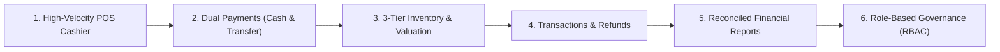

1. **High-Velocity Point of Sale (POS):**
   - Universal catalog browsing with category tabs and fast SKU / text search.
   - Native hardware barcode scanner listener for rapid keyboard buffer input.
   - Line-item quantity steppers, item removal, manual discount input, and Cart Holding (Hold / Resume Cart) to prevent cashier queue blockage.
2. **Dual MVP Payment Workflows:**
   - **Cash (Tunai):** Quick tender chips (Rp 10.000, 20.000, 50.000, 100.000, Exact), live change calculation, and insufficient tender validation.
   - **Manual Bank Transfer:** Displays merchant bank details (BCA, Mandiri), unique transfer note generator, and 60-minute stock reservation window.
3. **Product & Multi-Sector Catalog Management:**
   - Support for 8 commercial units (`pcs`, `kg`, `liter`, `cup`, `pack`, `gram`, `porsi`, `order`).
   - Modal forms capturing SKU/barcode, selling price, cost price (HPP), live profit margin calculator, and low-stock reorder thresholds.
   - Category management modal with inline deletion safeguards.
4. **3-Tier Inventory & Dual Asset Valuation:**
   - Real-time stock tracking:
     $$\text{Stok Tersedia (Available)} = \text{Stok Fisik (On-Hand)} - \text{Stok Dipesan (Reserved)}$$
   - Dual valuation balance sheet: Physical warehouse asset value ($\text{On-Hand} \times \text{HPP}$) vs. liquid sellable inventory value ($\text{Available} \times \text{HPP}$).
   - Stock opname adjustment modal with mandatory audit reason codes (`RUSAK`, `KEDALUWARSA`, `HILANG`, `SELISIH_OPNAME`, `KOREKSI_ADMIN`).
5. **Transactions Ledger & Controlled Refunds:**
   - Real-time order history filterable by status (`SELESAI`, `MENUNGGU_TRANSFER`, `REFUND`), cashier, and date.
   - Bank transfer verification queue requiring Manager/Owner elevation.
   - Itemized customer refund modal with mandatory reason codes and automatic stock restock toggles.
6. **Reconciled Financial Reporting & Analytics:**
   - Mathematical hierarchy:
     $$\text{Net Sales} = \text{Gross Sales} - \text{Discounts} - \text{Refunds}$$
   - Zero-variance receipts balance: Net Cash Drawer (Rp 2.700.000) + Verified BCA Transfer (Rp 570.000) = Net Sales (Rp 3.270.000).
   - Real-time COGS/HPP tracking with gross profit margin (50.5%).
7. **Team & Role-Based Access Control (RBAC):**
   - Three distinct staff roles: **Owner**, **Manager**, and **Cashier**.
   - Server-enforced elevation tokens for sensitive manager actions (refunds, bank verification, stock opname).

---

## 3. Design System Overview

Designed natively in **FigCraft**, the design system delivers accessible, high-contrast, and ergonomic components:

- **Primary Brand Theme:** Deep Teal (`#0F766E` / Tailwind `teal-700`) with a contrast ratio of **5.47:1** against white surfaces (WCAG 2.1 AA compliant).
- **Secondary Surfaces:** Crisp white cards (`#FFFFFF`) on a subtle Slate background (`#F8FAFC`).
- **Typography:** **Inter** sans-serif font family with strict proportional line heights.
- **Iconography:** **Lucide Icons** with uniform 2px stroke width (`stroke-width="2"`).
- **Spacing Scale:** 4px baseline grid (`4px`, `8px`, `12px`, `16px`, `24px`, `32px`).
- **Component Mapping:** 1:1 mapping to official [shadcn/ui](https://ui.shadcn.com) primitives (`Button`, `Input`, `Dialog`, `Sheet`, `Table`, `Badge`, `Card`).

---

## 4. Design Previews

### Desktop Web Experience (1440 × 900 px)

#### Web Cashier Register & Shopping Cart (Node ID `1686`)
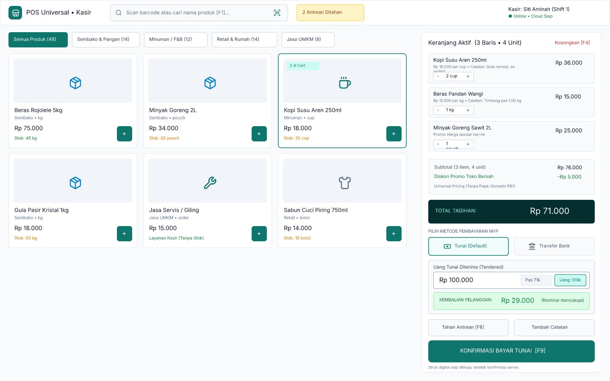

#### Web Cash Checkout Tender & Change Calculation (Node ID `2092`)
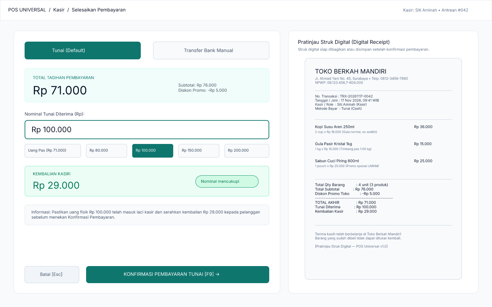

#### Web Product Catalog & Multi-Unit Inventory (Node ID `3006`)
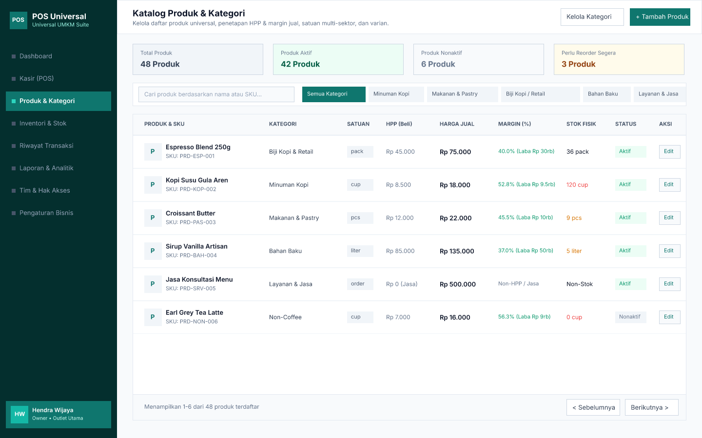

#### Web Sales Analytics & Reconciled Financial Reports (Node ID `4059`)
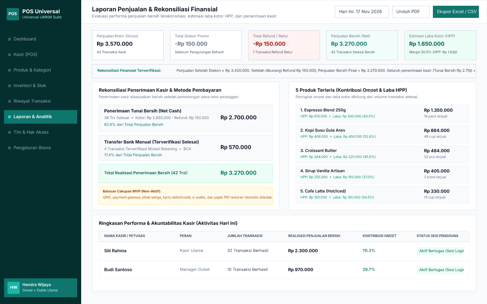

---

### Mobile Web / Android Browser Experience (390 × 844 px)

| Mobile Cashier Catalog (Node 1877) | Mobile Cart Review (Node 2009) | Mobile Digital Receipt (Node 2264) |
| :---: | :---: | :---: |
| 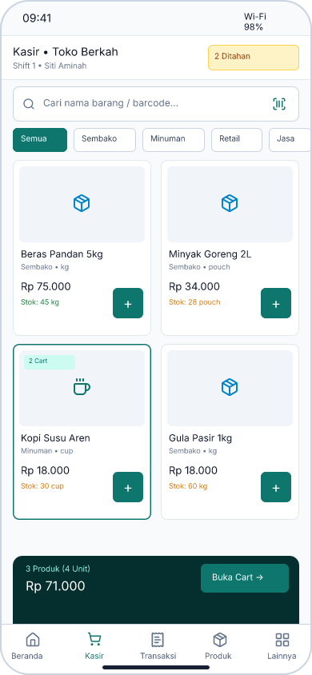 | 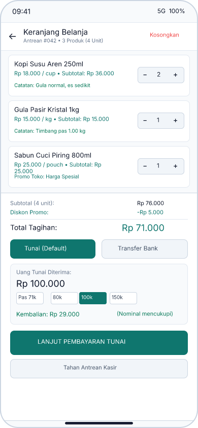 | 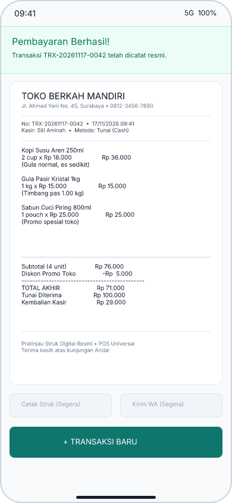 |

| Mobile Inventory Overview (Node 3682) | Mobile Transactions Feed (Node 3963) | Mobile Sales Reports (Node 4199) |
| :---: | :---: | :---: |
| 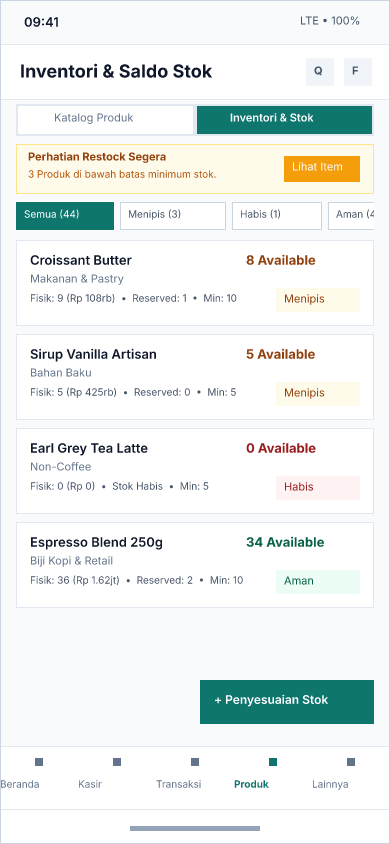 | 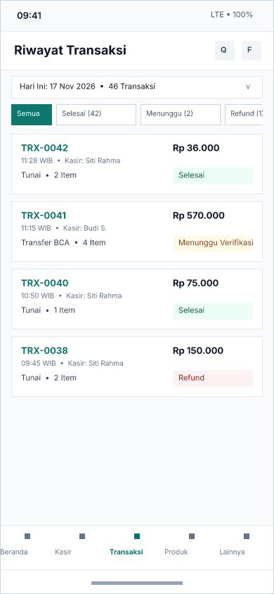 | 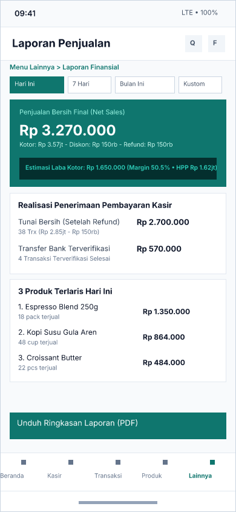 |

---

### Operational UI States & Edge Cases

| Cash Insufficient Warning (Node 2289) | Transfer Verification Dialog (Node 2315) | Bank Transfer Expiring (Node 2423) |
| :---: | :---: | :---: |
| 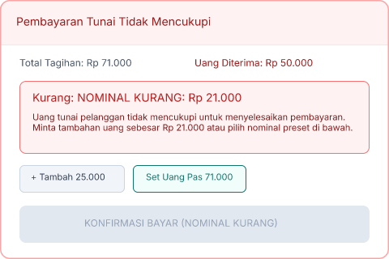 | 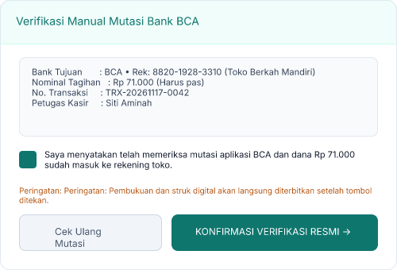 | 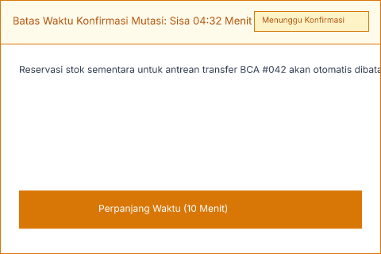 |

---

## 5. Repository Structure

```text
pos-universal-design/
├── README.md                      # Primary project overview and design gallery
├── .gitignore                     # Selective Git exclusions (clean repository)
├── design/
│   ├── figcraft/                  # Authoritative native FigCraft design documents
│   │   ├── POS Universal — Design Foundation.figcraft
│   │   ├── POS Universal — Phase 2 Core Screens.figcraft
│   │   └── POS Universal — Phase 3 Business Management.figcraft
│   ├── screenshots/               # High-fidelity exported screenshot assets
│   │   ├── desktop/               # 18 Desktop Web screens & modals (1440x900)
│   │   ├── mobile/                # 20 Mobile Web / Android touch screens (390x844)
│   │   └── states/                # 15 Dedicated operational state cards & edge cases
│   └── assets/                    # Additional design assets & brand marks
├── docs/
│   ├── product-overview.md        # Vision, target UMKM sectors, MVP boundaries
│   ├── design-system.md           # Deep Teal tokens, typography, shadcn/ui mapping
│   ├── screen-inventory.md        # Complete inventory of 53 screens, routes, and roles
│   ├── user-flows.md              # Mermaid sequence diagrams and state machines (FSM)
│   └── developer-handoff.md       # Accounting formulas, RBAC, API headers, tech stack
└── walkthrough/
    ├── 01-design-foundation.md    # Phase 1 walkthrough: tokens, components, app shells
    ├── 02-core-screens.md         # Phase 2 walkthrough: auth, cashier, dual checkout, states
    ├── 03-business-management.md  # Phase 3 walkthrough: catalog, inventory, refunds, reports
    ├── 04-design-audit.md         # Phase 4 walkthrough: corrections, QRIS pruning, PIN removal
    └── 05-final-architecture-handoff.md # Phase 5 walkthrough: architecture mapping & status
```

---

## 6. Design Walkthrough Index

Explore the step-by-step engineering walkthrough documenting every design milestone, decision, and correction:

- [Walkthrough 01 — Design Foundation & Application Shells](walkthrough/01-design-foundation.md): Explains design tokens, Deep Teal color choice, component primitives, and the evolution from dual targets (Desktop + Android APK) to a single responsive Web app.
- [Walkthrough 02 — Core Screens & Transaction Workflows](walkthrough/02-core-screens.md): Details authentication (why role selector was removed), cashier register layout (desktop split vs. mobile drawer), dual payment flows, and 11 essential operational states.
- [Walkthrough 03 — Business Management & Operational Governance](walkthrough/03-business-management.md): Covers multi-unit catalog management, 3-tier inventory equation ($Available = OnHand - Reserved$), refund governance, and financial reporting.
- [Walkthrough 04 — Design Audit, Addendum & Corrections](walkthrough/04-design-audit.md): Documents the Phase 4 visual and mathematical audit, including QRIS pruning, elimination of client-side PIN bypasses, consolidation to a responsive Web app, and reconciliation of sales metrics.
- [Walkthrough 05 — Final Architecture & Engineering Handoff](walkthrough/05-final-architecture-handoff.md): Outlines the mapping of design nodes to the production tech stack (React + Vite + shadcn/ui + Supabase + Vercel) and project readiness status.

---

## 7. Developer Handoff Summary

The design specifications are mapped directly to implementation contracts in [docs/developer-handoff.md](docs/developer-handoff.md):

- **Accounting Formulas:** Enforces $\text{Net Sales} = \text{Gross Sales} - \text{Discounts} - \text{Refunds}$ balancing with cashier drawer receipts ($\text{Net Cash} + \text{Verified Transfer}$).
- **Inventory Concurrency:** Enforces row-level locking (`SELECT FOR UPDATE`) on checkout and automated `pg_cron` reservation release after 60 minutes.
- **Security & RBAC:** Enforces server-side elevation tokens for Manager/Owner actions; no client-side security shortcuts.
- **Idempotency Standards:** All checkout and refund POST requests require a unique `Idempotency-Key` (UUIDv4) header.

---

## 8. Project Readiness & Status

| Milestone | Scope | Status | Notes |
| :--- | :--- | :---: | :--- |
| **Phase 1: Design Foundation** | Tokens, Components, Responsive Shells | **Completed** | Approved native FigCraft document |
| **Phase 2: Core Screens** | Auth, Cashier POS, Dual Checkout, UI States | **Completed** | Approved native FigCraft document |
| **Phase 3: Business Management** | Products, Inventory, Refunds, Reports, Team | **Completed** | Approved native FigCraft document |
| **Phase 4: Design Audit** | Mathematical Reconciliation, Security Hardening | **Completed** | 100% Verified Pass |
| **Phase 5: Architecture Handoff**| Specification Package & Schema Mapping | **Completed** | Ready for implementation |
| **Application Implementation**| React + Vite + Supabase Codebase | **In Progress** | Maintained in separate repository |
| **Production Deployment** | Public Vercel / Supabase Instance | **Pending** | Pending frontend/backend build |
