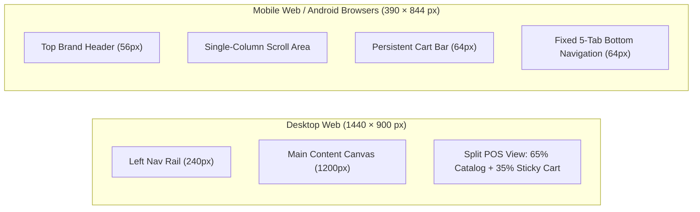

# POS Universal — Design System Specification

**Design Tool:** Native FigCraft (`.figcraft`)  
**Design Foundation File:** `design/figcraft/POS Universal — Design Foundation.figcraft`  
**Color Palette:** Deep Teal Brand Theme (`#0F766E`)  
**Typography:** Inter Font Family (Sans-serif)  
**Iconography:** Lucide Icons (2px consistent stroke)  
**Implementation Mapping:** Tailwind CSS + shadcn/ui (React + TypeScript)  

---

## 1. Visual Identity & Brand Philosophy

The visual design system of POS Universal is created with a professional, calming, and high-trust enterprise palette centered around **Deep Teal (`#0F766E`)**. 

For Indonesian small business owners and cashiers who interact with the interface for 8 to 12 hours a day in retail shops, cafes, and grocery stalls, visual ergonomics are paramount. Deep Teal provides:
1. **WCAG 2.1 AA Compliance:** High contrast ratio of **5.47:1** against white surfaces for optimal legibility under varying store lighting conditions.
2. **Reduced Visual Fatigue:** A balanced, nature-inspired palette that avoids the harshness of high-saturation neon blues or clinical grays.
3. **Professional Authority:** Instills trust and reliability during monetary checkout and sensitive financial auditing.

---

## 2. Color Palette & Semantic Design Tokens

All colors are codified as CSS variables and Tailwind theme extensions:

| Token Name | Hex Code | Tailwind Utility | WCAG Contrast | Usage Context |
| :--- | :--- | :--- | :--- | :--- |
| `primary` | `#0F766E` | `bg-teal-700` / `text-teal-700` | 5.47:1 (AA) | Primary action buttons, active navigation indicators, key highlights |
| `primary-hover` | `#0D655E` | `hover:bg-teal-800` | 6.82:1 (AAA)| Interactive hover state for primary buttons |
| `primary-surface`| `#F0FDFA` | `bg-teal-50` | N/A | Active menu item background, selected row highlight |
| `primary-foreground`| `#FFFFFF` | `text-white` | 5.47:1 (AA) | Text and icons placed on primary colored backgrounds |
| `background` | `#F8FAFC` | `bg-slate-50` | N/A | Application body background behind cards |
| `surface` | `#FFFFFF` | `bg-white` | N/A | Main cards, modals, sheets, dropdown menus |
| `border` | `#E2E8F0` | `border-slate-200` | N/A | Structural table borders, form input borders, card outlines |
| `border-focus` | `#0F766E` | `focus:border-teal-700` | N/A | Form input focus ring (2px) |
| `text-primary` | `#0F172A` | `text-slate-900` | 15.6:1 (AAA)| Page headings, primary table data, card titles |
| `text-secondary`| `#475569` | `text-slate-600` | 7.0:1 (AAA) | Form field labels, descriptive subtitles, secondary metrics |
| `text-muted` | `#64748B` | `text-slate-500` | 4.6:1 (AA) | Metadata, input placeholders, SKU identifiers |
| `success` | `#16A34A` | `text-emerald-600` / `bg-emerald-600` | 4.5:1 (AA) | Completed transactions (`SELESAI`), positive stock opname |
| `success-surface`| `#F0FDF4` | `bg-emerald-50` | N/A | Success badge background, verified transfer banner |
| `warning` | `#D97706` | `text-amber-600` / `bg-amber-600` | 4.5:1 (AA) | Pending verification (`MENUNGGU_TRANSFER`), low stock alerts |
| `warning-surface`| `#FFFBEB` | `bg-amber-50` | N/A | Pending reservation chip, simulation disclaimer banner |
| `danger` | `#DC2626` | `text-rose-600` / `bg-rose-600` | 4.5:1 (AA) | Refunds (`REFUND`), negative adjustments, delete actions |
| `danger-surface` | `#FEF2F2` | `bg-rose-50` | N/A | Error banner, insufficient cash alert container |

---

## 3. Typography Scale & Hierarchy

The interface uses the **Inter** sans-serif font family, configured with strict proportional line-heights for crisp rendering across desktop screens and high-DPI Android mobile displays:

```text
Display / H1       24px / 32px (Bold 700)      • Page titles, dashboard financial KPIs
Title / H2         18px / 24px (Semibold 600)  • Section headers, modal titles, card headers
Subtitle / H3      16px / 22px (Semibold 600)  • Product card names, sub-section dividers
Body Regular       14px / 20px (Regular 400)   • Table cells, descriptions, form text
Body Medium        14px / 20px (Medium 500)    • Button labels, active tab items, table headers
Caption / Small    12px / 16px (Regular 400)   • Input helper text, SKU subtitles, timestamps
Badge / Micro      11px / 14px (Semibold 600)  • Uppercase status badges (SELESAI, DIPESAN)
```

---

## 4. Spacing Scale & Corner Radii

### 4.1 4px Spacing Grid
The spatial composition strictly follows a 4px baseline grid to ensure perfect alignment:
- `space-1` (4px): Micro gaps between icon and text inside buttons.
- `space-2` (8px): Form input inner vertical padding, badge padding.
- `space-3` (12px): Form input inner horizontal padding, grid gaps.
- `space-4` (16px): Card internal padding, table cell padding.
- `space-6` (24px): Page container gutter, major layout section margins.
- `space-8` (32px): Modal padding, desktop dashboard section gaps.

### 4.2 Corner Radii
- `radius-sm` (4px): Small buttons, filter tags, status badges.
- `radius-md` (8px): Form inputs, dropdowns, table row hover highlights.
- `radius-lg` (12px): Standard cards, dialog modals, desktop panels.
- `radius-xl` (16px): Mobile bottom sheet containers, mobile action cards.
- `radius-full` (9999px): Avatar containers, floating action buttons, pill filters.

---

## 5. Iconography

POS Universal standardizes exclusively on **Lucide Icons** with a consistent **2px stroke width** (`stroke-width="2"`):
- `ShoppingCart`: POS checkout, active cart summary.
- `Package`: Product catalog, inventory items.
- `Layers`: Category management.
- `ArrowDownUp`: Stock opname, stock movement tracking.
- `Receipt`: Transactions history, receipt print action.
- `BarChart3`: Reports, sales analytics, gross profit metrics.
- `Users`: Team management, cashier shifts.
- `Settings`: Store settings, bank accounts.
- `CheckCircle2` / `AlertCircle` / `XCircle`: Status feedback.

---

## 6. Component Mapping to shadcn/ui

The FigCraft design components map 1:1 to official [shadcn/ui](https://ui.shadcn.com) primitives:

| FigCraft Design Component | shadcn/ui Primitive | Customization & Styling |
| :--- | :--- | :--- |
| **Primary Button** | `<Button />` | `bg-teal-700 hover:bg-teal-800 text-white font-medium h-10 px-4 rounded-md` |
| **Secondary Button** | `<Button variant="outline" />` | `border-slate-200 text-slate-700 hover:bg-slate-50 h-10 px-4 rounded-md` |
| **Destructive Button** | `<Button variant="destructive" />` | `bg-rose-600 hover:bg-rose-700 text-white font-medium h-10 px-4 rounded-md` |
| **Text Input / Search** | `<Input />` | `border-slate-200 focus-visible:ring-teal-700 text-slate-900 h-10 px-3 rounded-md` |
| **Category Select** | `<Select />` | `<SelectTrigger />` + `<SelectContent />` styled with slate borders and teal hover |
| **Status Badge** | `<Badge />` | Custom variants: `success` (emerald), `warning` (amber), `danger` (rose), `neutral` (slate) |
| **Data Cards** | `<Card />` | `<CardHeader />`, `<CardContent />`, `<CardFooter />` with `border-slate-200 shadow-sm` |
| **Modal Dialog** | `<Dialog />` | Used for Add Product, Hold Cart, Stock Opname, Category Management (max-w-2xl) |
| **Mobile Drawer / Sheet**| `<Sheet />` | Used for Mobile Product Details, Stock Adjustment, and Mobile Cart Sheet |
| **Data Table** | `<Table />` | Styled with `text-slate-900`, subtle divider lines, and hover highlight on rows |
| **Tabs Navigation** | `<Tabs />` | `<TabsList />` with active indicator styled in teal (`data-[state=active]:bg-teal-50 data-[state=active]:text-teal-700`) |

---

## 7. Responsive Layout Principles

POS Universal delivers a seamless experience across desktop and mobile web viewports without requiring a separate native application code base:



### Desktop Web (1440 × 900 px)
- Permanent 240px navigation sidebar with quick access to POS, Dashboard, Catalog, Inventory, Transactions, Reports, Team, and Settings.
- Split-screen cashier view: 65% product catalog grid (3-4 columns) and 35% sticky order checkout sidebar.
- Multi-column tables with inline sortable columns and batch action bars.

### Mobile Web / Android Browsers (390 × 844 px)
- Fixed top bar (56px) with store selector, active cashier indicator, and barcode scanner shortcut.
- Single-column touch-optimized cards with 44px minimum tap targets.
- Persistent floating bottom cart bar showing active item count and subtotal.
- Standard 5-tab bottom navigation bar (`Beranda | Kasir | Transaksi | Produk | Lainnya`).
