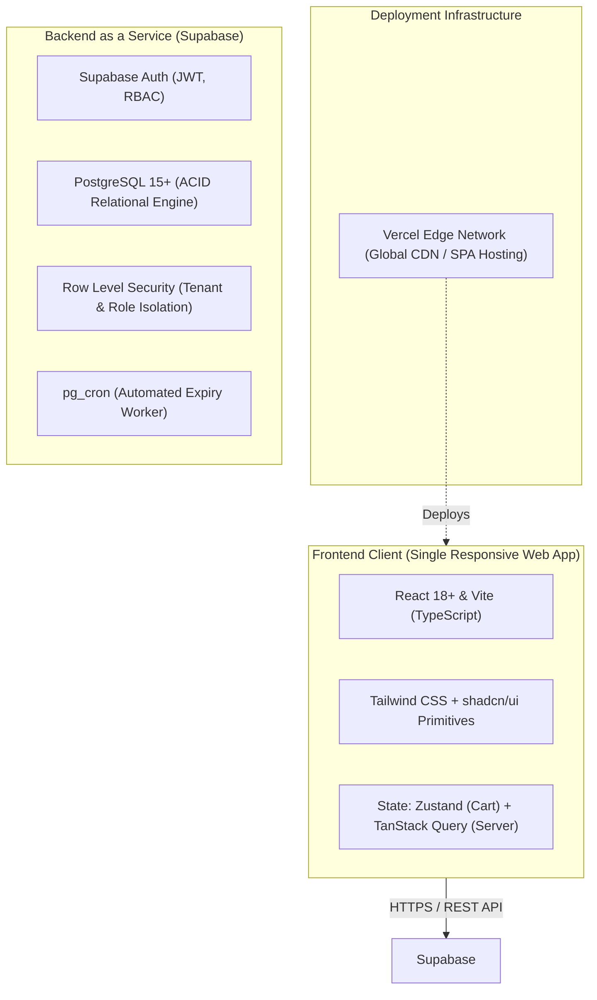

# POS Universal — Developer Handoff Specification

**Document ID:** `POS-DOC-HANDOFF`  
**Version:** 1.0.0  
**Target Platform:** Responsive Web Application (Desktop Web 1440 × 900 px & Android Mobile Web 390 × 844 px)  
**Target Stack:** React 18+, Vite, TypeScript, Tailwind CSS, shadcn/ui, Supabase (PostgreSQL 15+), Vercel  

---

## 1. Technical Architecture & Tech Stack



### Key Technology Selections
1. **Frontend:** React with Vite provides blazing fast HMR, small bundle sizes, and rapid loading on mobile Android browsers.
2. **UI Framework:** Tailwind CSS with official **shadcn/ui** primitives ensures accessible, copy-pasteable, zero-runtime-overhead components matching FigCraft design nodes.
3. **Backend & Database:** **Supabase** delivers enterprise PostgreSQL 15+ with native Row Level Security (RLS), real-time capabilities for cashier shift updates, and built-in JWT authentication.
4. **Hosting:** **Vercel** provides automated CI/CD and atomic deployments.

---

## 2. Core Business Formulas & Accounting Constants

The engineering team must implement exact accounting semantics to guarantee zero discrepancy across reports, cash registers, and inventory balances.

### 2.1 Sales & Reporting Hierarchy
$$\text{Penjualan Bersih (Net Sales)} = \text{Penjualan Kotor (Gross Sales)} - \text{Total Diskon} - \text{Total Refund}$$

**Verified Audit Reference Period:**
$$\text{Gross Sales: Rp 3.570.000} - \text{Discounts: Rp 150.000} - \text{Refunds: Rp 150.000} = \mathbf{Rp\ 3.270.000}$$

> [!IMPORTANT]
> The metric `Penjualan Setelah Diskon (Rp 3.420.000)` represents pre-refund sales. It must never be labeled as Net Sales when refunds occurred in the reporting period.

### 2.2 Payment Receipts Reconciliation
Physical cash in the drawer plus verified bank transfer receipts must balance 100% against Net Sales:
- **Net Cash Drawer Receipts:** $\text{Rp 2.850.000} - \text{Rp 150.000 (Refund Disbursed)} = \mathbf{Rp\ 2.700.000}$ (38 transactions)
- **Verified Bank Transfers (BCA):** $\mathbf{Rp\ 570.000}$ (4 transactions)
- **Total Realized Receipts:** $\text{Rp 2.700.000} + \text{Rp 570.000} = \mathbf{Rp\ 3.270.000}$ (Matches Net Sales with **0.00 IDR variance**).

### 2.3 COGS / HPP & Margin
- **HPP (Harga Pokok Penjualan):** $\mathbf{Rp\ 1.620.000}$ (across 42 net sales transactions).
- **Estimasi Laba Kotor (Gross Profit):**
  $$\text{Laba Kotor} = \text{Net Sales (Rp 3.270.000)} - \text{HPP (Rp 1.620.000)} = \mathbf{Rp\ 1.650.000}$$
- **Margin Laba Kotor:**
  $$\text{Gross Margin} = \left(\frac{1.650.000}{3.270.000}\right) \times 100\% = \mathbf{50.46\% \ (\approx 50.5\%)}$$
- **Service Products Rule:** Items categorized as service/labor (`unit = 'order'`) have `HPP = Rp 0` and `track_inventory = false`. Their margin must display `Non-HPP / Jasa (N/A)`.

### 2.4 Inventory Equation & Dual Asset Valuation
$$\text{Stok Tersedia (Available)} = \text{Stok Fisik (On-Hand)} - \text{Stok Dipesan (Reserved)}$$
- **Nilai Aset Fisik:** $\sum (\text{Stok Fisik} \times \text{HPP})$ — Official balance-sheet warehouse inventory value.
- **Nilai Stok Tersedia:** $\sum (\text{Stok Tersedia} \times \text{HPP})$ — Liquid sellable inventory value.
- **Nilai Alokasi Dipesan:** $\sum (\text{Stok Dipesan} \times \text{HPP})$ — Inventory committed to pending transfers.

---

## 3. Role-Based Access Control (RBAC) Matrix

| Feature / Action | Cashier (Kasir) | Manager (Manajer Toko) | Owner (Pemilik) | Enforcement Mechanism |
| :--- | :---: | :---: | :---: | :--- |
| **Login & Access POS Workspace** | ✅ Full | ✅ Full | ✅ Full | Session token |
| **Search Products & Scan Barcodes**| ✅ Full | ✅ Full | ✅ Full | Client UI + Cache |
| **Add / Edit Cart Items & Hold Cart**| ✅ Full | ✅ Full | ✅ Full | Zustand Store |
| **Accept Cash Payments** | ✅ Full | ✅ Full | ✅ Full | POST `/transactions` |
| **Initiate Bank Transfer Reservation**| ✅ Full | ✅ Full | ✅ Full | POST `/transactions` |
| **Verify Manual Bank Transfer** | ❌ Blocked | ✅ Allowed | ✅ Allowed | Requires Manager elevation token |
| **Initiate Customer Refund** | ❌ Elevation Req | ✅ Allowed | ✅ Allowed | Requires Manager elevation token |
| **Perform Stock Opname / Correction**| ❌ Blocked | ✅ Allowed | ✅ Allowed | RLS: `role IN ('MANAGER','OWNER')` |
| **Create / Edit Products & Prices**| ❌ Blocked | ✅ Allowed | ✅ Allowed | RLS: `role IN ('MANAGER','OWNER')` |
| **View COGS / HPP & Profit Margins**| ❌ Blocked | ✅ Allowed | ✅ Allowed | Backend projection exclusion |
| **View Store Financial Reports** | ❌ Blocked | ✅ Allowed | ✅ Allowed | RLS: `role IN ('MANAGER','OWNER')` |
| **Manage Team Members & Roles** | ❌ Blocked | ❌ Blocked | ✅ Allowed | RLS: `role = 'OWNER'` |
| **Configure Bank Accounts & Profile**| ❌ Blocked | ❌ Blocked | ✅ Allowed | RLS: `role = 'OWNER'` |

---

## 4. API Request Standards & Global Headers

All mutating requests from the client must include mandatory audit and idempotency headers:

```http
POST /api/v1/transactions HTTP/1.1
Host: api.posuniversal.id
Authorization: Bearer <supabase_jwt_token>
Content-Type: application/json
Idempotency-Key: 7b8c2d9e-1a3f-4e5b-9c8d-2f1a3e5b7c9d
X-Outlet-ID: out_jaksel_01
X-Client-Platform: web-desktop (or web-mobile-android)
```

### Idempotency Protection
To eliminate accidental double charges caused by flaky cellular connections on mobile web browsers, the backend checks `Idempotency-Key` within a Redis / PostgreSQL uniqueness cache for a 120-second TTL. Duplicate requests return the original transaction receipt response without repeating stock deductions.

---

## 5. Recommended Frontend Feature Directory Structure

```text
src/
├── assets/                  # Brand SVG logos, illustrations
├── components/
│   ├── ui/                  # Official shadcn/ui components (Button, Input, Dialog, etc.)
│   └── common/              # App-wide components (RupiahDisplay, BarcodeScannerListener)
├── features/
│   ├── auth/                # Login form, session provider, RoleGuards
│   ├── pos/                 # Catalog grid, cart sidebar, payment modals, receipt
│   ├── catalog/             # Product table, product modal, category modal
│   ├── inventory/           # 3-tier stock table, stock adjustment modal
│   ├── transactions/        # Transaction list, filter bar, refund modal
│   ├── reports/             # Sales summary, reconciliation card, profit metrics
│   ├── team/                # Team table, invite modal, role assignment
│   └── settings/            # Business settings, bank account management
├── hooks/                   # useBarcodeScanner, useIdempotency, useNetworkStatus
├── lib/                     # formatRupiah, mathUtils, cn helper
├── stores/                  # useCartStore (Zustand), useUiStore
├── routes/                  # App router with desktop and mobile layouts
└── types/                   # Shared TypeScript models and database types
```
