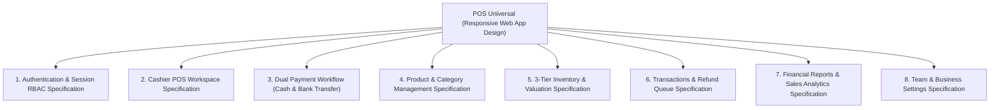

# POS Universal — Product Overview

**Project:** POS Universal (Sistem Kasir & Manajemen Bisnis UMKM)  
**Target Platform:** Responsive Web Application (Desktop Web 1440 × 900 px & Mobile Web / Android Browsers 390 × 844 px)  
**Target Audience:** Indonesian Micro, Small, and Medium Enterprises (UMKM)  
**Target Sectors:** Retail Stores, Coffee Shops / Kedai Kopi, Food & Pastry, Grocery Stores (Sembako), Small Service Businesses (Jasa UMKM)  
**Planned Technology Stack:** React 18+, Vite, TypeScript, Tailwind CSS, shadcn/ui, Supabase (PostgreSQL 15+), Vercel  
**Document Purpose:** Product Requirements & Design Specification (Application implementation resides in a separate workspace)  

---

## 1. Executive Summary & Problem Statement

Indonesian Micro, Small, and Medium Enterprises (UMKM) form over 97% of domestic employment, yet the majority operate with fragmented, error-prone manual bookkeeping or cumbersome legacy Point of Sale (POS) software. Existing solutions in the market suffer from distinct critical flaws:

1. **Sector Inflexibility:** Most POS applications cater exclusively to either standard packaged retail (fixed barcodes and `pcs`) or restaurants (table management), failing businesses that combine physical goods, bulk commodities by weight (`kg`, `gram`), beverages by volume (`cup`, `liter`), and service fees (`order`).
2. **Financial Semantics Confusion:** Frequent conflation between Gross Sales, Discounts, Refunds, and Realized Cash Receipts leads to inaccurate tax reporting, cash drawer discrepancies, and false profit calculations.
3. **Inventory Blindspots:** Failing to distinguish between physical stock on shelves (*On-Hand*) and stock committed to pending bank transfer orders (*Reserved*) causes frequent overselling and customer disputes.
4. **Platform Fragility & App Store Overhead:** Heavy native Android APKs impose update distribution delays, high device maintenance overhead, and platform lock-in for small merchants using diverse hardware (Chromebooks, desktop PCs, laptops, and Android mobile web browsers).

### Architectural Evolution: From Dual Targets to a Single Responsive Web Application
The POS Universal design process originally drafted two parallel UI reference targets: Web Desktop (1440 × 900 px) and Android touch-first layouts (390 × 844 px). During subsequent technical evaluations, the engineering architecture was consolidated into a **single, responsive Web application**. 

The 390 × 844 px layouts now serve as the definitive specification for the **Mobile Web and Android mobile browser** experience, completely eliminating the need for a separate native Android APK while maintaining touch-first ergonomics.

---

## 2. Multi-Sector Scope & Supported Commercial Units

A core strength of the POS Universal catalog specification is its unified multi-sector model. Rather than forcing merchants into restrictive retail-only or restaurant-only silos, POS Universal natively supports 8 standard commercial units within a single unified product schema:

| Unit Code | Unit Name | Typical Sector / Application | Inventory Tracking | Decimal Support |
| :--- | :--- | :--- | :--- | :--- |
| `pcs` | Pieces / Satuan | Retail, Fashion, Packaged F&B | Yes (Integer) | No |
| `pack` | Pack / Dus / Bungkus | Wholesale, Cigarettes, Snack packs | Yes (Integer) | No |
| `kg` | Kilogram | Grocery (Sembako), Coffee beans, Meat | Yes (Decimal) | Yes (e.g., 0.25 kg) |
| `gram` | Gram | Spices, Premium tea, Bakery ingredients | Yes (Decimal) | Yes (e.g., 250 g) |
| `liter` | Liter | Cooking oil, Syrup, Fresh milk | Yes (Decimal) | Yes (e.g., 1.5 L) |
| `cup` | Cup / Gelas | Coffee shops, Bubble tea, Juice stands | Yes (Integer) | No |
| `porsi` | Porsi / Piring | Warung makan, Pastry, Catering | Yes (Integer) | No |
| `order` | Order / Jasa | Repair, Delivery, Menu consulting | **No** (Service item) | No |

### Non-Inventory & Service Items
Service items (e.g., *Jasa Penggilingan Kopi*, *Biaya Antar*) are specified with `track_inventory = false` and `hpp = 0`. In reporting specifications, gross profit margin is labeled as `Non-HPP / Jasa (N/A)` rather than misrepresenting profit as a 100% markup.

---

## 3. Core Functional Design Specifications

> [!NOTE]
> The modules below define the approved UI/UX design specifications, workflow rules, and planned backend contracts. Actual application code is maintained and implemented in a separate application repository.

### 3.1 Authentication & Role-Based Access Control (RBAC) Specification
- **Unified Login:** Single credential entry (Email + Password) with server-resolved RBAC. Users are not forced to self-select roles on the login screen.
- **Role Hierarchy:**
  * **Owner (Pemilik):** Full governance over financial reports, COGS/HPP margins, bank accounts, team management, and audit logs.
  * **Manager (Manajer Toko):** Operational supervisor with rights to verify manual bank transfers, approve refunds, perform stock opname, and manage product prices.
  * **Cashier (Kasir):** Operational POS specialist restricted to processing sales, holding carts, accepting cash, initiating bank transfer reservations, and viewing personal shift history.
- **Elevation Tokens:** Cashiers cannot self-verify bank transfers or approve customer refunds. Sensitive actions trigger an elevation prompt requiring an authorized Manager or Owner authorization token.

### 3.2 Point of Sale (POS) Cashier Workspace Specification
- **High-Velocity Cashier UI:** 65% catalog browse/search grid and 35% sticky order cart on desktop web; full-width catalog with persistent bottom cart bar on mobile web.
- **Barcode & SKU Scanning:** Native hardware scanner event listener capturing rapid keyboard buffer inputs.
- **Cart Governance:** Quantity adjustments, line-item discounts, and temporary Cart Holding (Hold / Resume Cart) to prevent queue blockages.

### 3.3 Dual MVP Payment System Specification
To maintain bulletproof financial reliability, the MVP focuses strictly on the two ubiquitous payment methods of Indonesian commerce:
1. **Tunai (Cash):**
   - Quick denomination chips (Rp 10.000, Rp 20.000, Rp 50.000, Rp 100.000, and Exact Amount).
   - Real-time change calculation (`Kembalian = Uang Diterima - Total Tagihan`).
   - Insufficient cash validation blocking checkout until tender is complete.
2. **Transfer Bank Manual:**
   - Displays merchant bank accounts (e.g., Bank Central Asia - BCA, Bank Mandiri).
   - Generates unique customer transfer notes referencing the Order ID.
   - Places items in **Reserved** inventory status with a planned 60-minute automated expiry window.
   - Requires authorized Manager or Owner verification before order completion.

### 3.4 3-Tier Inventory & Dual Asset Valuation Specification
- **Inventory Equation:**
  $$\text{Stok Tersedia (Available)} = \text{Stok Fisik (On-Hand)} - \text{Stok Dipesan (Reserved)}$$
- **Dual Valuation Balance Sheet:**
  * **Nilai Aset Fisik:** $\text{On-Hand} \times \text{HPP}$ (warehouse physical inventory value).
  * **Nilai Stok Tersedia:** $\text{Available} \times \text{HPP}$ (liquid sellable inventory value).
- **Audit-Grade Stock Adjustments:** Stock opname and damage corrections require explicit reason codes (`RUSAK`, `KEDALUWARSA`, `HILANG`, `SELISIH_OPNAME`, `KOREKSI_ADMIN`).

### 3.5 Transaction Governance & Refund Workflow Specification
- **Transaction History:** Real-time filterable order ledger tracking payment method, cashier ID, order status, and customer notes.
- **Controlled Refund System:**
  * Full or partial item returns.
  * Mandatory refund reason code selection (`BARANG_CACAT`, `SALAH_PESAN`, `KUALITAS_BURUK`, `LAINNYA`).
  * Automatic stock restock toggle.
  * Ledger logging and financial deduction against Net Sales.

### 3.6 Financial Reporting & Reconciliation Specification
- **Accounting Reconciliation Equation:**
  $$\text{Penjualan Bersih (Net Sales)} = \text{Penjualan Kotor (Gross Sales)} - \text{Diskon} - \text{Pengembalian (Refunds)}$$
- **Receipts Balance Verification:**
  $$\text{Total Realisasi Penerimaan} = \text{Kasir Tunai Bersih} + \text{Transfer Terverifikasi} = \text{Penjualan Bersih}$$
- **COGS / HPP & Margin:** Planned Gross Profit calculation with explicit gross margin percentages.

---

## 4. MVP Explicit Boundaries & Future Roadmap

To ensure rapid delivery, zero scope creep, and architectural stability, POS Universal strictly demarcates MVP inclusions from post-MVP expansions:

| Feature Area | In-Scope MVP Design | Explicitly Excluded from MVP (Post-MVP Roadmap) |
| :--- | :--- | :--- |
| **Payments** | Cash (Tunai) & Manual Bank Transfer | Automated QRIS, Payment Gateway (Midtrans/Xendit), EDC Cards |
| **Deployment** | Single Responsive Web App (Desktop + Mobile Web) | Native Android APK / Google Play Store, iOS App Store |
| **Catalog** | Multi-unit single products & variants | Multi-level composite raw material recipe BOM (Bill of Materials) |
| **Inventory** | Single store / outlet balance with 3-tier tracking | Inter-branch stock transfer, multi-warehouse supply chain |
| **Hardware** | USB/Bluetooth barcode scanner & standard printer | Dedicated ESC/POS thermal printer raw byte driver bridge |
| **Accounting** | Gross Sales, Discounts, Refunds, Net Sales, COGS | Double-entry general ledger, tax filing, balance sheet assets |
| **Customer** | Cashier guest checkout & simple customer name | Formal customer loyalty points, member tiers, store credits |
