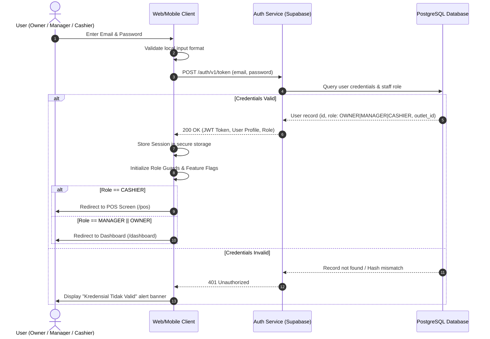
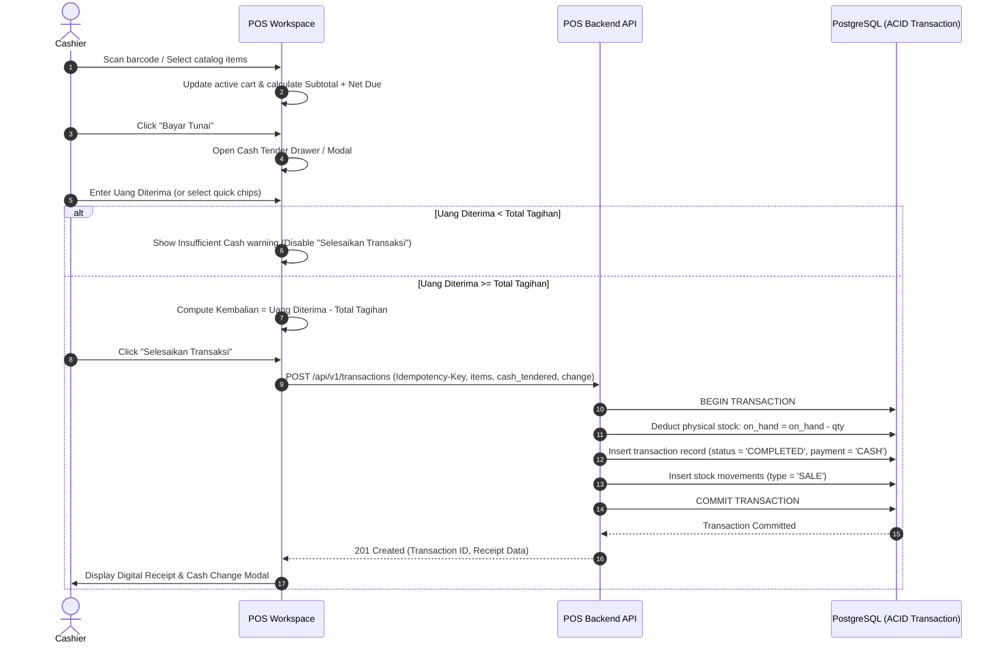
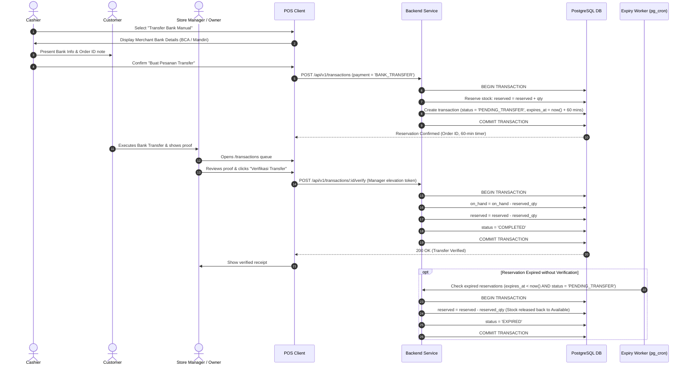
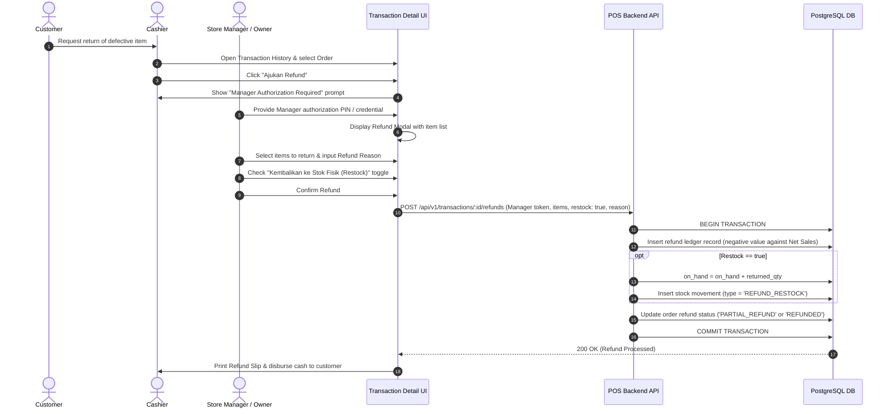
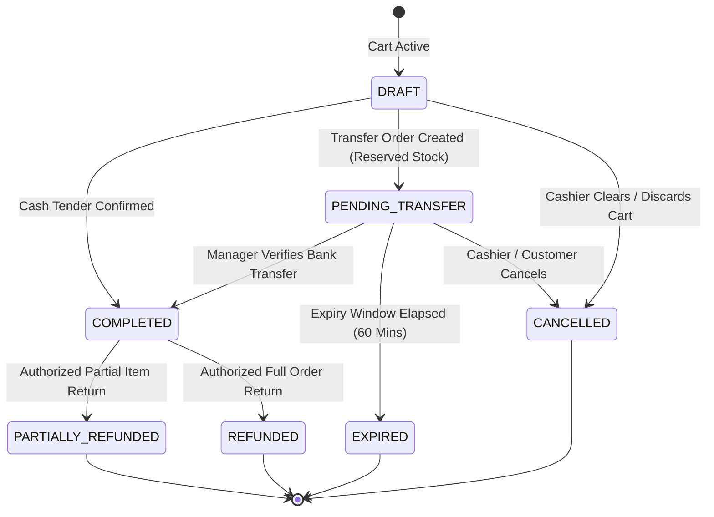
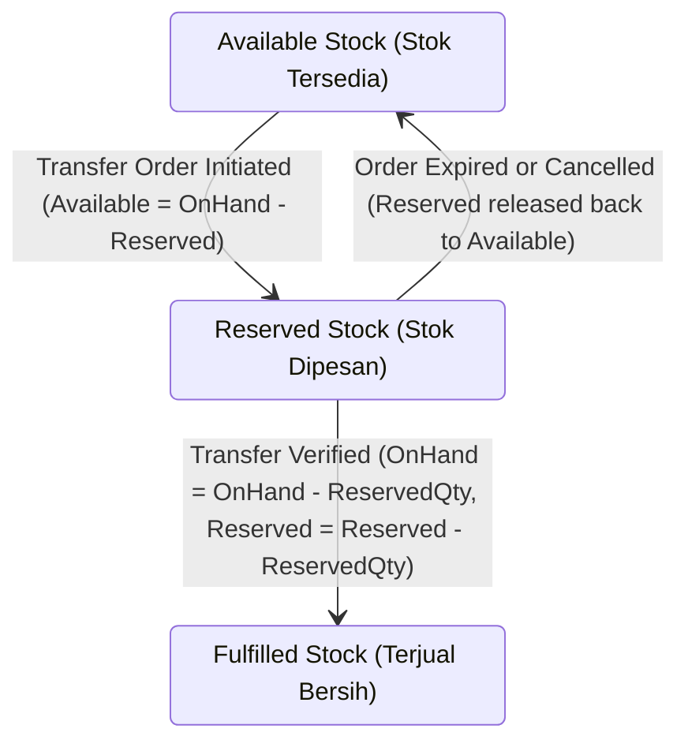

# POS Universal — User Flows & State Transitions

This document details the core operational flows, state machines, and sequence interactions implemented across POS Universal.

---

## 1. Authentication & Session RBAC Flow

Unlike consumer applications, POS Universal removes role selection tabs from the login interface. The server resolves permissions upon validating credentials:

---

## 2. Cash (Tunai) Checkout Flow

Cash checkout is optimized for speed, safety, and strict change calculation:

---

## 3. Manual Bank Transfer & Inventory Reservation Flow

Manual bank transfer requires an order reservation window to prevent overselling while awaiting customer transfer:

---

## 4. Refund & Restock Workflow

Customer returns require manager authorization and explicit accounting:

---

## 5. State Machines (FSM)

### 5.1 Transaction State Machine

### 5.2 Stock Reservation Lifecycle

