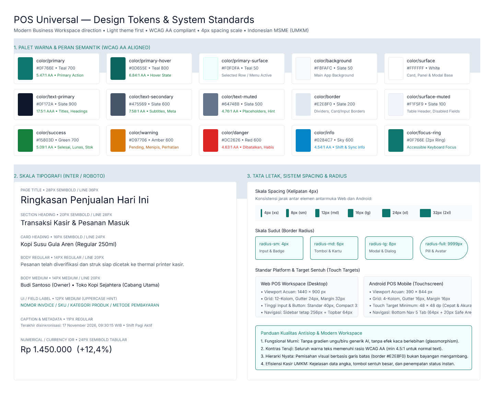
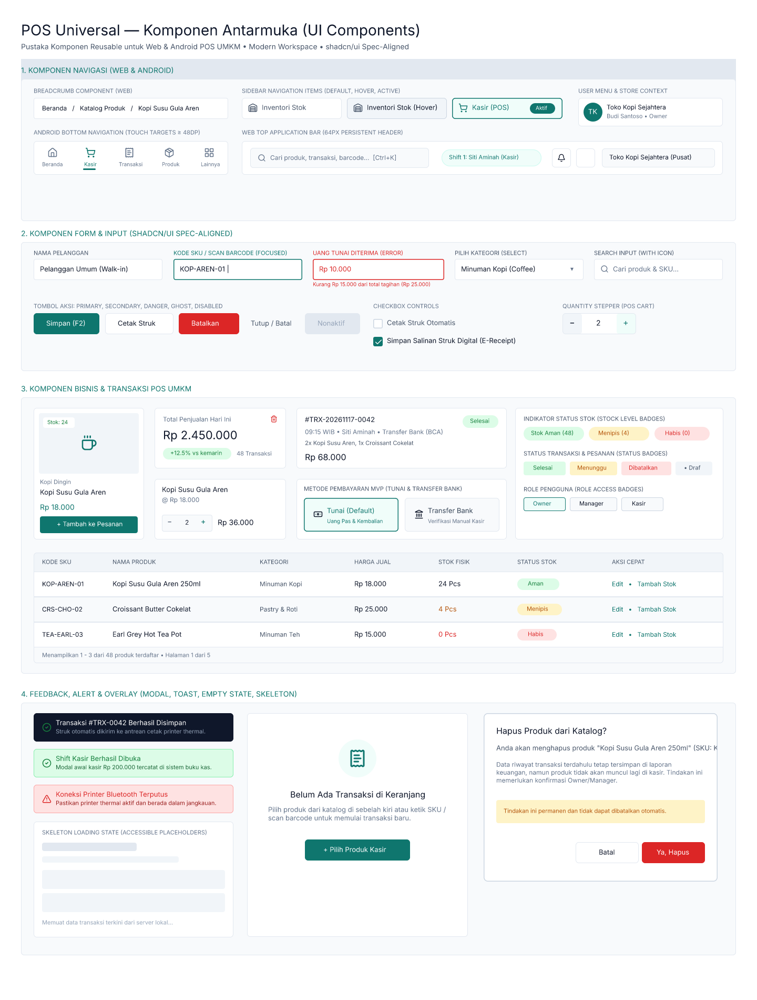
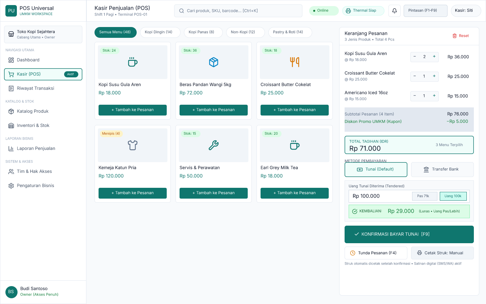
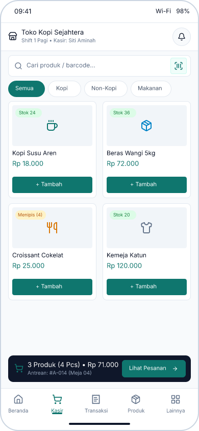
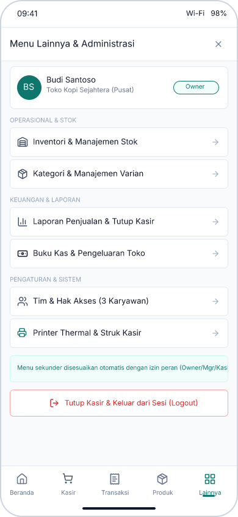
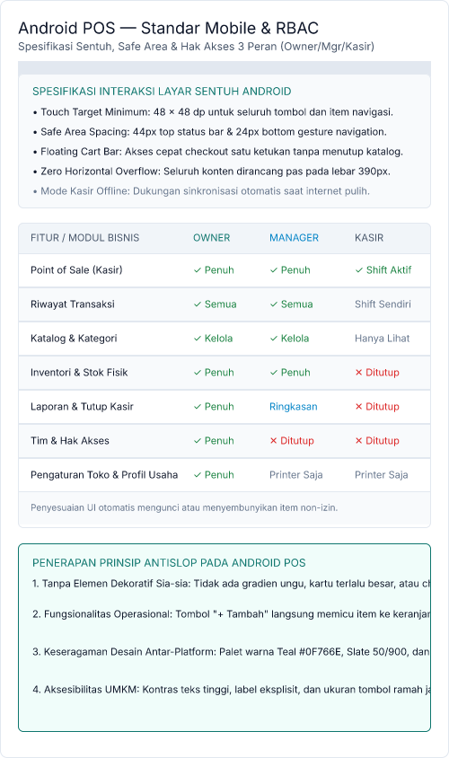

# Walkthrough 01 — Design Foundation & Application Shells

**Design Phase:** Phase 1  
**Native Source File:** `design/figcraft/POS Universal — Design Foundation.figcraft`  
**Focus:** Design Tokens, Reusable UI Components, Web & Mobile Application Shells  

---

## 1. Initial Objective

The objective of Phase 1 was to establish an authoritative visual design language, atomic token architecture, reusable component library, and responsive application shells for **POS Universal**. 

The design process commenced by exploring two parallel reference surfaces:
1. **Desktop Web Shell (1440 × 900 px):** Designed for high-frequency keyboard/barcode cashier register shifts.
2. **Android-Oriented Touch Shell (390 × 844 px):** Designed for compact, touch-first mobile interaction.

---

## 2. Design Requirements

- **Design System Codification:** Codify foundational tokens: color palette, typography scales, 4px spatial baseline, corner radii, elevation shadows, and status colors.
- **Component Library:** Build accessible, modular UI primitives: buttons, form inputs, dropdown selectors, status badges, modal dialogs, and data cards.
- **Responsive Shell Layouts:**
  * **Desktop Shell (1440 × 900 px):** Fixed 240px navigation sidebar, header utility bar, and fluid main canvas.
  * **Mobile Touch Shell (390 × 844 px):** 56px branded top app bar, touch-friendly scroll canvas, and 64px 5-tab bottom navigation bar.

---

## 3. Key Business Considerations

1. **Diverse Indonesian UMKM Hardware:** Small business merchants in Indonesia operate on diverse computing equipment, ranging from refurbished Intel Core i3 desktop PCs and touch Chromebooks to personal Android smartphones.
2. **Visual Ergonomics for Shift Workers:** Cashiers work 8- to 12-hour shifts. Bright neon blues or clinical stark-white interfaces cause eye strain and cognitive fatigue, increasing input errors during peak checkout hours.
3. **Touch-First Target Accessibility:** On mobile screens, tap targets must meet Apple Human Interface Guidelines and Google Material standards (minimum 44 × 44 pt / 48 × 48 dp) to prevent misclicks in crowded, fast-paced retail stalls.

---

## 4. Key Design Decisions & Architectural Evolution

### Decision 4.1: Architectural Evolution to a Single Responsive Web Application
In early project stages, the design foundation explored separate desktop web and native Android APK targets (with early documentation considering Jetpack Compose for Android). 

However, during subsequent architectural reviews, maintaining two independent codebases was evaluated as introducing significant friction for Indonesian UMKM:
- **Deployment Velocity:** Bug fixes and menu updates would face Google Play Store review delays.
- **Distribution Overhead:** Merchants operating diverse devices (Chromebooks, desktop PCs, laptops) benefit from zero-install web access.
- **Unified Decision:** The architecture was consolidated into a **single responsive Web application (React + Vite + Tailwind CSS)** deployed via Vercel. 

The 390 × 844 px Android design frames were retained as the authoritative specification for the **Mobile Web / Android browser** experience, preserving touch ergonomics without requiring a native APK.

### Decision 4.2: Deep Teal (`#0F766E`) as Brand Anchor
- Deep Teal (Tailwind `teal-700`) was selected as the brand color. It delivers a high contrast ratio of **5.47:1** against white card surfaces, comfortably exceeding the WCAG 2.1 AA requirement of 4.5:1.
- Unlike aggressive red or cold corporate blue, teal conveys calmness, security, and financial reliability.

### Decision 4.3: Navigation Architecture
- **Desktop:** Permanent 240px left-hand sidebar with instant access to POS, Dashboard, Catalog, Inventory, Transactions, Reports, Team, and Settings.
- **Mobile Web:** Standardized 5-tab bottom navigation bar:
  $$\text{Beranda} \quad|\quad \text{Kasir} \quad|\quad \text{Transaksi} \quad|\quad \text{Produk} \quad|\quad \text{Lainnya}$$
  Secondary administrative settings (Team, Bank, Audit) are organized inside the `Lainnya (More)` tab to maximize screen real estate for cashier operations.

---

## 5. Artifacts & Screenshot Previews

### Desktop Foundation Previews

#### Design Tokens — Color, Typography & Layout (Node ID `7`)

#### UI Component Library (Node ID `155`)

#### Web Application Shell (Node ID `390`)

---

### Mobile Touch Foundation Previews

#### Mobile POS Shell (Node ID `568`) & Lainnya Menu (Node ID `640`)
| Mobile POS Screen (Node 568) | Mobile Lainnya Menu (Node 640) |
| :---: | :---: |
|  |  |

#### Mobile Standards & RBAC Matrix (Node ID `687`)

---

## 6. Bridge to Phase 2

With foundational tokens, components, and responsive shell specifications approved in native FigCraft, Phase 2 progressed to designing the frontline transaction screens: Authentication, Cashier POS Workspace, Cart, and Checkout flows.
