# Walkthrough 02 — Core Screens & Transaction Workflows

**Design Phase:** Phase 2  
**Native Source File:** `design/figcraft/POS Universal — Phase 2 Core Screens.figcraft`  
**Focus:** Authentication, Cashier Workspace, Dual Checkout Flows, 11 Operational UI States  

---

## 1. Initial Objective

Phase 2 focused on creating the high-velocity operational screens that cashiers and store managers interact with continuously: user authentication, the cashier register workspace, shopping cart mechanics, checkout workflows, digital receipts, and edge-case operational states.

---

## 2. Design Requirements

1. **Authentication:** Clean, distraction-free login interface supporting email/identifier and password with clear state feedback (verifying, invalid credentials, success).
2. **Cashier Workspace:** High-velocity catalog browsing, real-time search, category filtering, barcode scanner support, and immediate cart updates.
3. **Cart Operations:** Line-item quantity steppers, item removal, manual discount input, and Cart Holding (Hold / Resume Cart) for queue management.
4. **Dual MVP Payment Workflows:**
   - **Cash (Tunai):** Quick tender chips, live change calculation, and insufficient tender validation.
   - **Manual Bank Transfer:** Active merchant bank details display (BCA, Mandiri), unique transfer note generator, and stock reservation disclaimer.
5. **Operational Edge States:** Dedicated screens for 11 critical operational scenarios (offline warnings, concurrent price updates, stock decreases, timeout recovery).

---

## 3. Important Business Considerations

1. **The "Queue Freeze" Problem:** In Indonesian retail and convenience stores, a customer at the cashier register often forgets an item or pauses to grab a cold beverage. Without a **Hold Cart** feature, the cashier must either void the entire transaction or make the entire queue wait.
2. **Transfer Proof Fraud Risk:** A prevalent fraud vector in Indonesia is the use of edited or fabricated mobile banking screenshots shown to young or hurried cashiers. Allowing cashiers to unilaterally mark bank transfers as "Paid" creates severe shrinkage. Hence, manual transfer verification is strictly restricted to Owner or Manager authorization.
3. **Stock Reservation Governance:** When a customer chooses manual bank transfer, the merchandise cannot be sold to another customer, yet the cash has not arrived. If the transaction is abandoned, the stock must automatically return to Available without manual manager intervention.

---

## 4. Key Design Decisions

### Decision 4.1: Elimination of Role Selection on Login
Earlier POS concepts featured tabs on the login screen (`[Owner] [Manager] [Cashier]`). This was decisively removed:
- **Security Hazard:** Prompting users to choose their role exposes internal organizational hierarchies and encourages credential stuffing against high-privilege roles.
- **Cognitive Confusion:** Users frequently selected the wrong tab despite entering valid credentials.
- **Server-Driven RBAC Specification:** The login screen now presents a single standard email and password form. In the planned architecture, upon successful authentication, the backend returns the staff member's cryptographically verified role in the JWT session payload, automatically routing Cashiers to `/pos` and Managers/Owners to `/dashboard`.

### Decision 4.2: Desktop Split-Screen vs. Mobile Two-Step UX
- **Desktop (1440 × 900 px):** Employs a 65% Catalog Grid and 35% Sticky Cart sidebar. Cashiers can scan, tap, add items, and review totals on a single screen without modal jumps.
- **Mobile Web / Android Browsers (390 × 844 px):** Because screen width is constrained, a two-step UX is adopted: a full-width catalog with a persistent floating bottom cart bar (`3 Items • Rp 85.000`), tapping which opens the dedicated Cart Screen or Bottom Sheet.

### Decision 4.3: 11 Dedicated Operational UI States
Rather than treating network failures or stock drops as generic modal popups, 11 dedicated state cards were designed directly into native FigCraft (IDs `2289`–`2431`) to specify:
- Insufficient cash tender validation.
- Idempotent in-flight transaction indicators.
- 60-minute bank transfer expiry countdowns.
- Network disconnection with read-only catalog fallbacks.

---

## 5. Artifacts & Screenshot Previews

### Desktop Core Screens

#### Web Login Screen (Node ID `1268`) & Owner Dashboard (Node ID `1376`)
| Web Login Screen (Node 1268) | Web Owner Dashboard (Node 1376) |
| :---: | :---: |
| 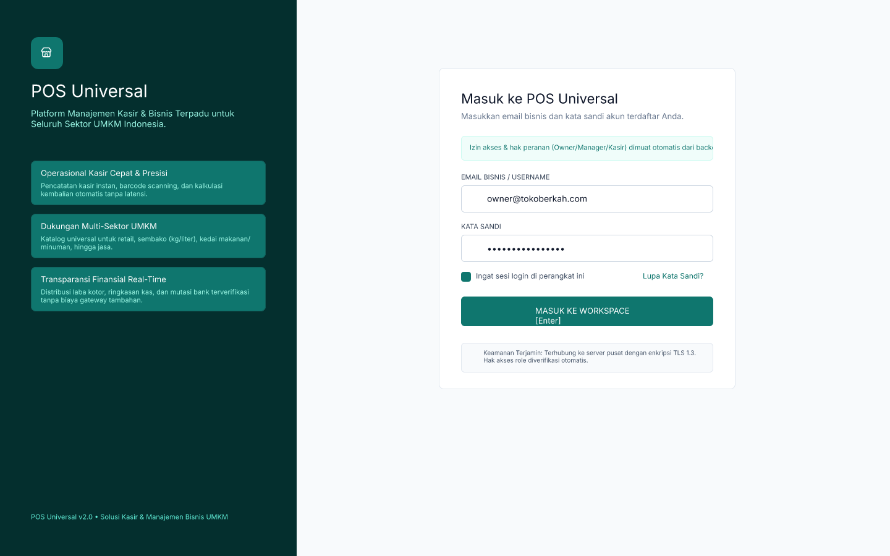 | 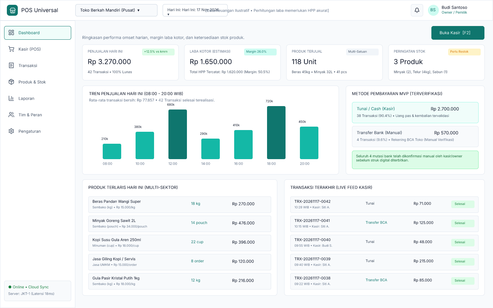 |

#### Web Cashier & Populated Cart (Node ID `1686`)
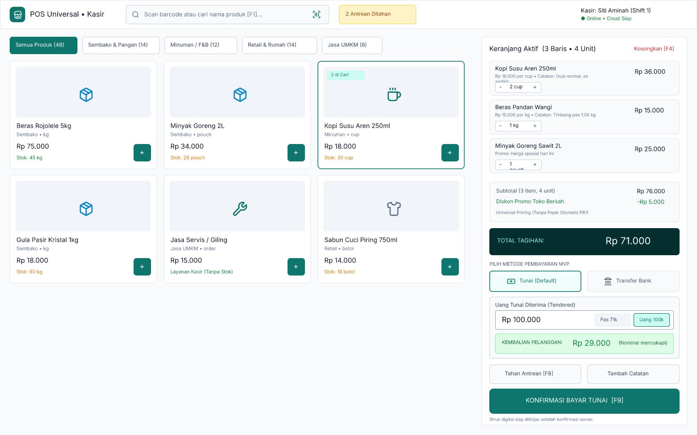

#### Web Checkout — Cash Flow (Node ID `2092`) & Bank Transfer Flow (Node ID `2151`)
| Web Cash Checkout (Node 2092) | Web Bank Transfer Checkout (Node 2151) |
| :---: | :---: |
| 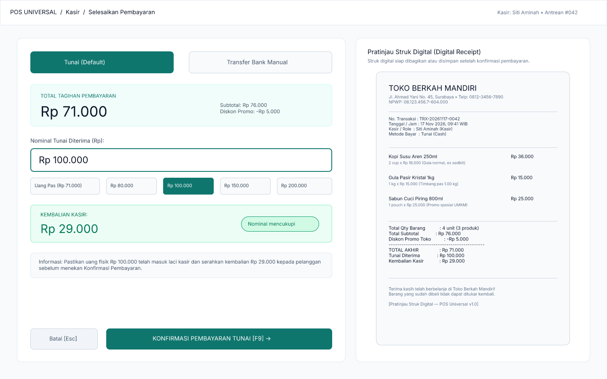 | 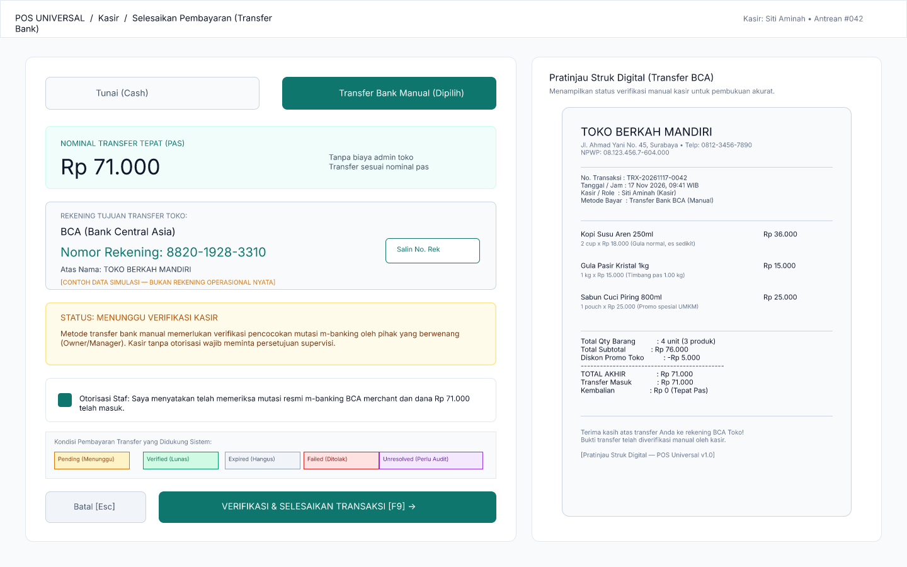 |

---

### Mobile Core Screens (Touch-First Mobile Web)

#### Mobile Login (Node 1327) & Mobile Dashboard (Node 1583)
| Mobile Login Screen | Mobile Owner Dashboard |
| :---: | :---: |
| 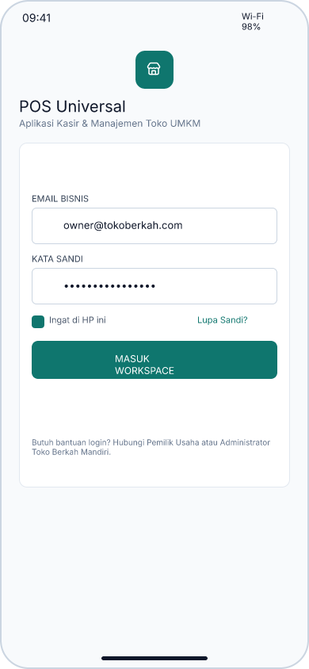 | 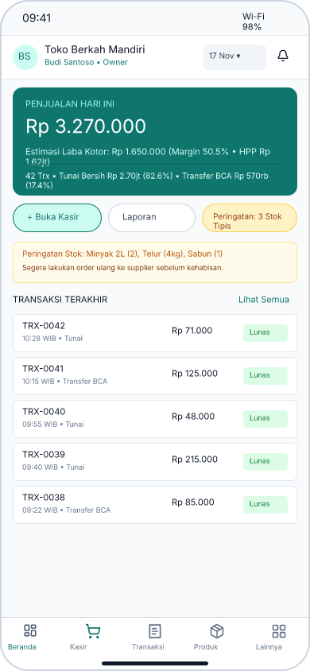 |

#### Mobile Cashier Catalog (Node 1877) & Dedicated Cart (Node 2009)
| Mobile Cashier Catalog | Mobile Dedicated Cart |
| :---: | :---: |
| 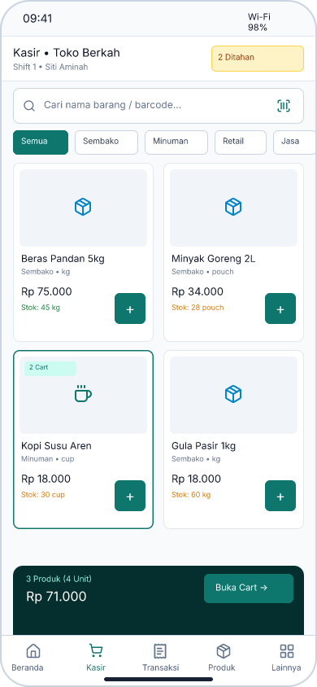 | 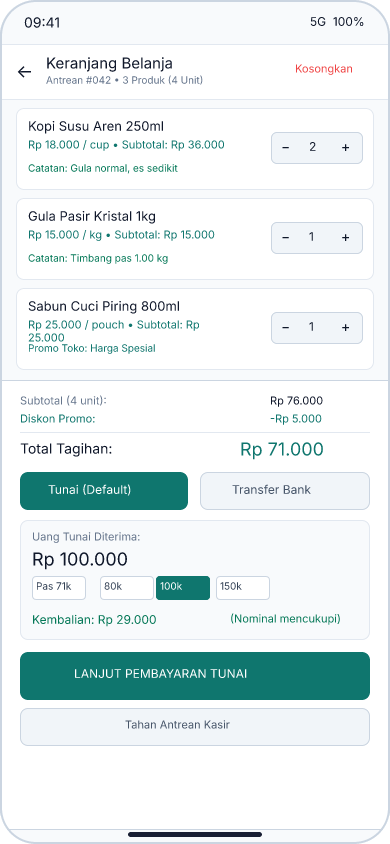 |

#### Mobile Checkout & Digital Receipt (Nodes 2204, 2237, 2264)
| Mobile Cash Tender (Node 2204) | Mobile Bank Transfer (Node 2237) | Mobile Digital Receipt (Node 2264) |
| :---: | :---: | :---: |
| 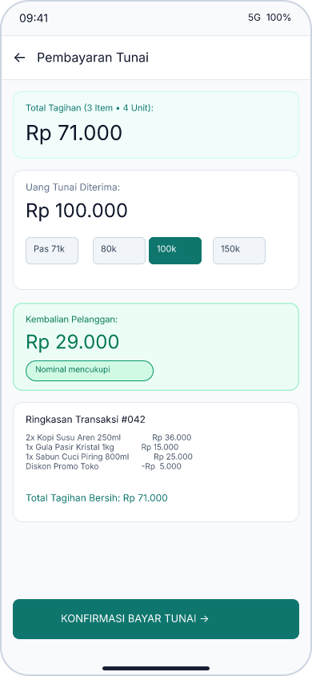 | 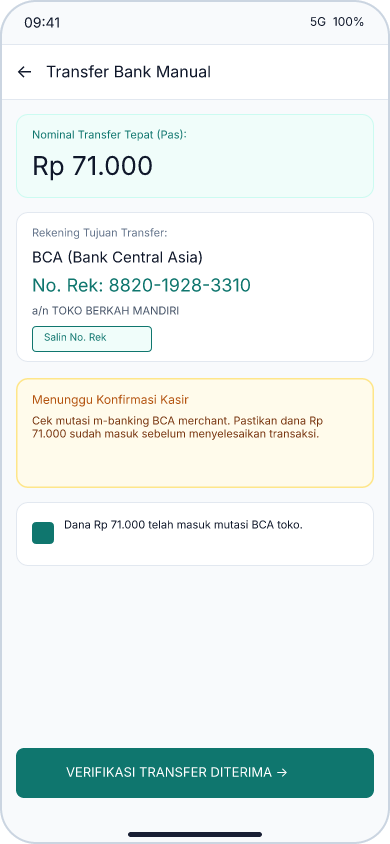 | 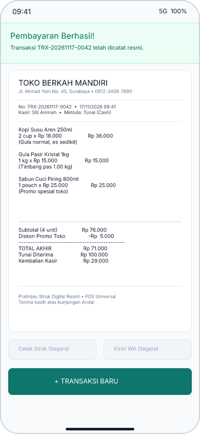 |

---

### Operational UI States & Edge Cases

| UI State 1: Cash Insufficient (Node 2289) | UI State 2: Hold Cart Dialog (Node 2303) | UI State 3: Transfer Verification (Node 2315) |
| :---: | :---: | :---: |
| 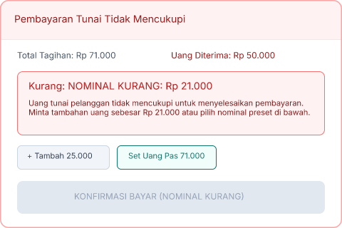 | 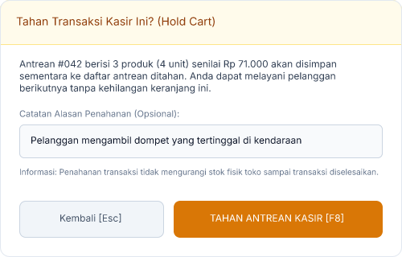 | 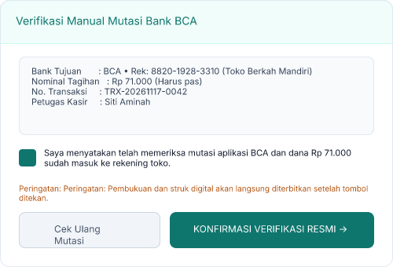 |

| UI State 4: Stock Warnings (Node 2328) | UI State 5: Offline Alert (Node 2383) | UI State 6: Checkout In-Flight (Node 2391) |
| :---: | :---: | :---: |
| 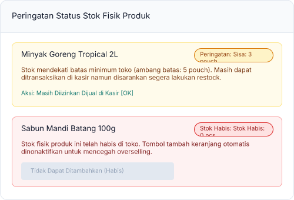 |  | 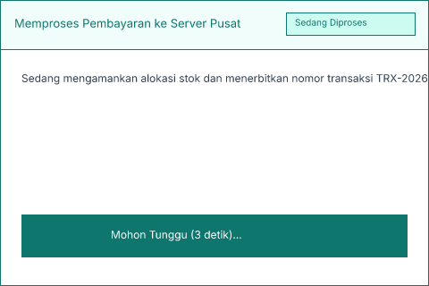 |

| UI State 7: Timeout Resolution (Node 2399) | UI State 8: Price Update Alert (Node 2407) | UI State 9: Stock Decrease Alert (Node 2415) |
| :---: | :---: | :---: |
| 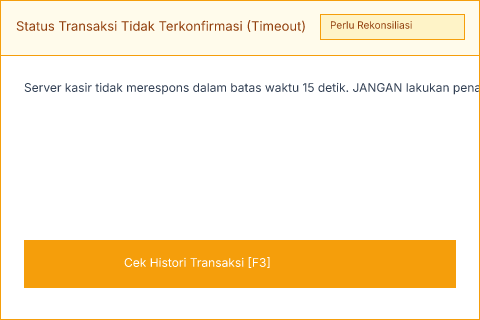 | 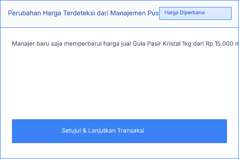 | 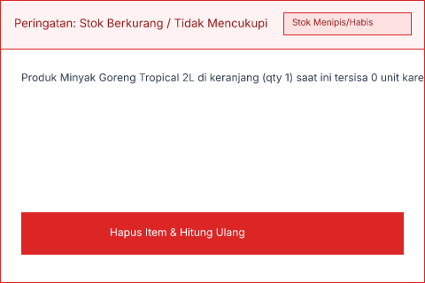 |

| UI State 10: Transfer Expiring (Node 2423) | UI State 11: Session Sync Recovery (Node 2431) | Empty Cart State (Node 2072) |
| :---: | :---: | :---: |
| 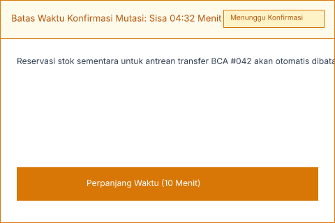 | 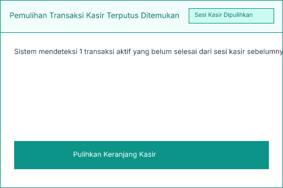 | 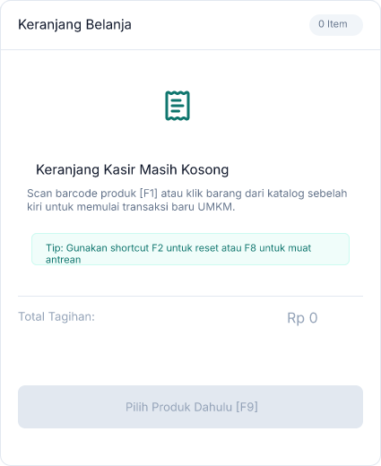 |

---

## 6. Bridge to Phase 3

Having established frontline transaction mechanics, Phase 3 designs the comprehensive administrative and business management backplane: Product catalog editing, multi-unit stock opname, transaction auditing, customer refunds, and executive reporting.
