# Walkthrough 03 — Business Management & Operational Governance

**Design Phase:** Phase 3  
**Native Source File:** `design/figcraft/POS Universal — Phase 3 Business Management.figcraft`  
**Focus:** Catalog Administration, 3-Tier Inventory Valuation, Transactions & Refunds, Financial Analytics, Store Settings  

---

## 1. Initial Objective

While Phase 2 addressed frontline cashier transactions, Phase 3 completed the operational lifecycle of POS Universal by designing the back-office business management suite. Store managers and owners require rigorous catalog management, real-time stock balance tracking, refund governance, and financial reports that balance to the exact rupiah.

---

## 2. Design Requirements

1. **Multi-Sector Catalog & Category CRUD:** Support 8 standard Indonesian commercial units (`pcs`, `kg`, `liter`, `cup`, `pack`, `gram`, `porsi`, `order`), variant builders, cost pricing (HPP), selling price, and real-time margin calculation.
2. **3-Tier Inventory Governance Specification:**
   $$\text{Stok Tersedia (Available)} = \text{Stok Fisik (On-Hand)} - \text{Stok Dipesan (Reserved)}$$
   Dual asset valuation distinguishing physical warehouse stock value from liquid available stock value.
3. **Stock Adjustment & Opname:** Rapid delta corrections with mandatory audit reason codes (`RUSAK`, `KEDALUWARSA`, `HILANG`, `SELISIH_OPNAME`, `KOREKSI_ADMIN`).
4. **Transactions Ledger & Refund Queue:** Order search, status filtering (`SELESAI`, `MENUNGGU_TRANSFER`, `REFUND`), itemized return handling with automatic restock toggling.
5. **Audit-Grade Financial Reporting:** Reconciled sales hierarchy:
   $$\text{Net Sales} = \text{Gross Sales} - \text{Discounts} - \text{Refunds}$$
   balancing 100% against Net Cash Drawer Receipts plus Verified Bank Transfers.
6. **Store & Team Administration:** Staff member management, role assignment (Owner, Manager, Cashier), store profile, and merchant bank account configuration.

---

## 3. Important Business Considerations

1. **The Cost of Blind Inventory:** Many small retailers fail to track inventory costs, only knowing their product count without knowing the capital tied up on shelves. POS Universal specifies **Dual Asset Valuation**:
   - **Nilai Aset Fisik:** $\text{On-Hand} \times \text{HPP}$ (balance-sheet inventory asset value).
   - **Nilai Stok Tersedia:** $\text{Available} \times \text{HPP}$ (liquid sellable inventory value).
2. **Shrinkage Accountability:** Unexplained inventory losses ("shrinkage") represent 2–5% of lost revenue for UMKM. By specifying mandatory reason codes for every stock adjustment, business owners can identify whether losses stem from supplier spoilage, cashier theft, or stocktaking counting errors.
3. **Receipts vs. Sales Discrepancy:** Cashiers often report physical cash deficits at shift close. POS Universal separates Gross Cash tender from Cash Refund disbursements, ensuring that Net Cash Drawer Receipts reconcile with audited sales.

---

## 4. Key Design Decisions

### Decision 4.1: Multi-Unit Selection without Rigid Category Silos
Traditional POS software forces users into pre-defined "Food" or "Retail" modes. POS Universal unifies all sectors: a boutique coffee shop can sell a cup of latte (`cup`), a bag of roasted beans (`gram`), a retail mug (`pcs`), and a barista class (`order`) within a single order.

### Decision 4.2: Separation of Sales After Discounts vs. Net Sales
The financial reporting specifications explicitly separate:
- **Penjualan Setelah Diskon (Rp 3.420.000):** Completed pre-refund sales.
- **Penjualan Bersih Final (Rp 3.270.000):** Realized net revenue after deducting Rp 150.000 in customer refunds.
This prevents false tax reporting and ensures alignment with Indonesian tax and accounting standards.

### Decision 4.3: Controlled Refund Governance
Refunds cannot be arbitrarily executed by cashiers. The refund interface specifies:
- Specific item selection (cashiers can refund 1 out of 3 items in an order).
- A mandatory refund reason (`BARANG_CACAT`, `SALAH_PESAN`, `KUALITAS_BURUK`, `LAINNYA`).
- A restock toggle (defective items are discarded and not returned to available stock; undamaged items return to physical stock).

---

## 5. Artifacts & Screenshot Previews

### Desktop Business Management Screens (1440 × 900 px)

#### Product Catalog (Node 3006) & Add Product Modal (Node 3189)
| Web Product Catalog (Node 3006) | Web Add/Edit Product Modal (Node 3189) |
| :---: | :---: |
| 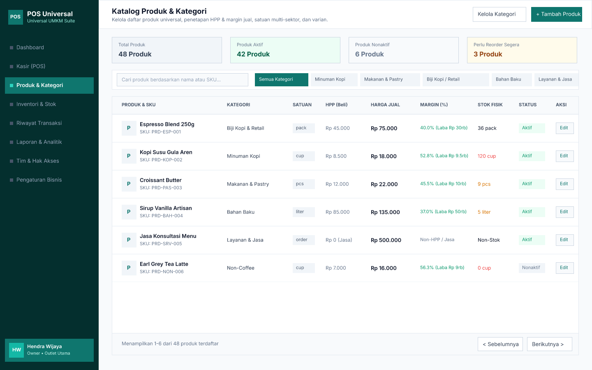 | 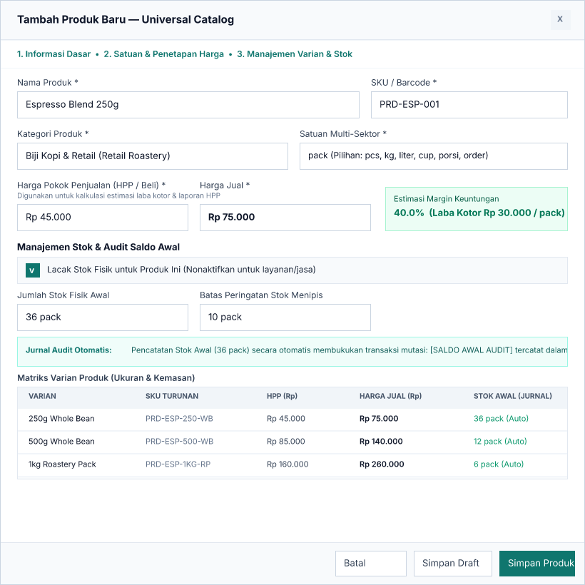 |

#### Category Management (Node 3265) & Inventory Overview (Node 3485)
| Web Category Modal (Node 3265) | Web Inventory Overview (Node 3485) |
| :---: | :---: |
| 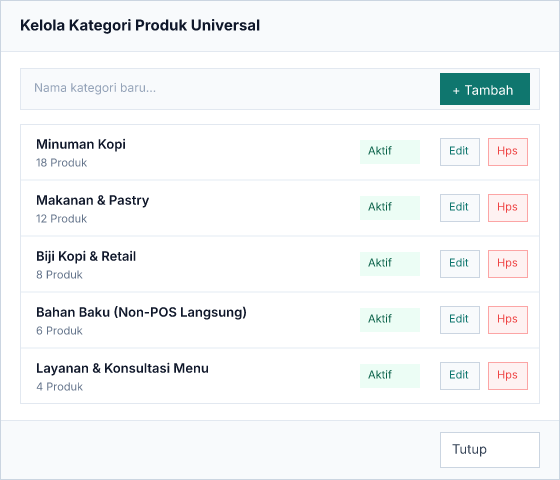 | 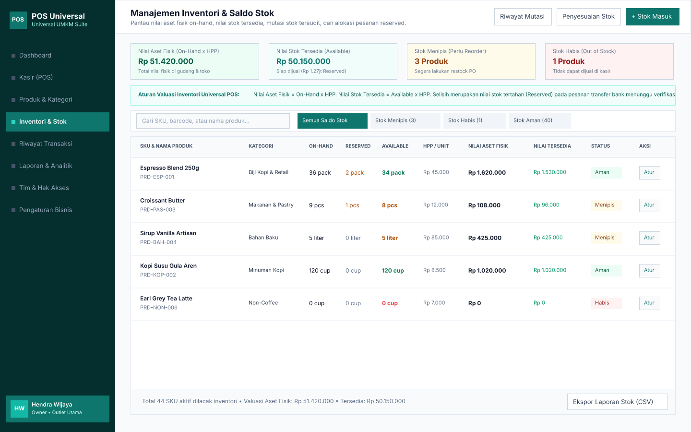 |

#### Stock Adjustment Modal (Node 3646) & Transactions Ledger (Node 3791)
| Web Stock Adjustment Modal (Node 3646) | Web Transaction Ledger (Node 3791) |
| :---: | :---: |
| 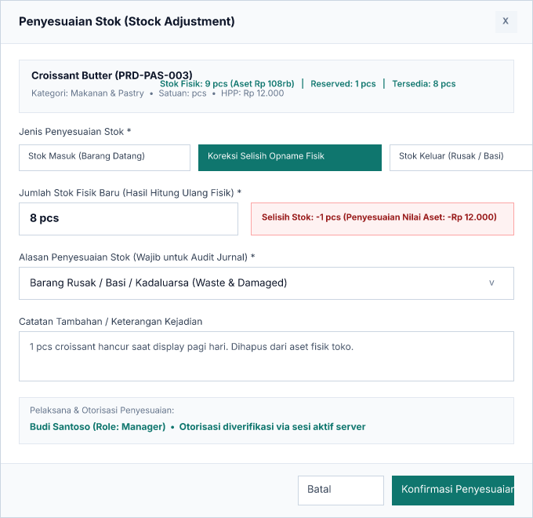 | 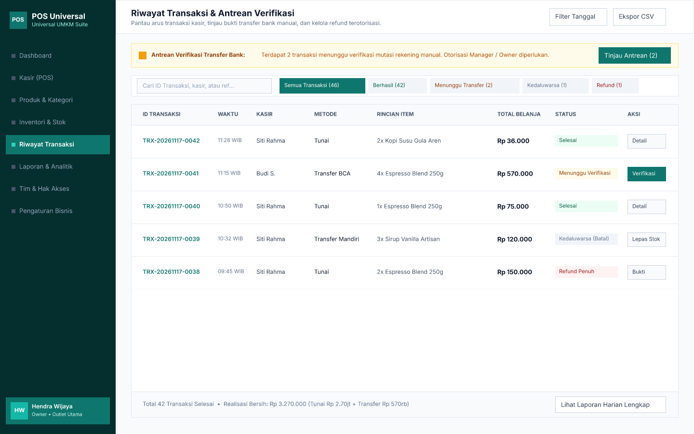 |

#### Transaction Detail & Refund Modal (Node 3922) & Sales Reports (Node 4059)
| Web Refund Modal (Node 3922) | Web Sales Analytics & Reports (Node 4059) |
| :---: | :---: |
| 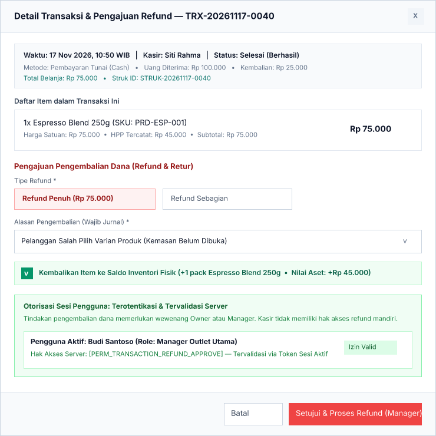 | 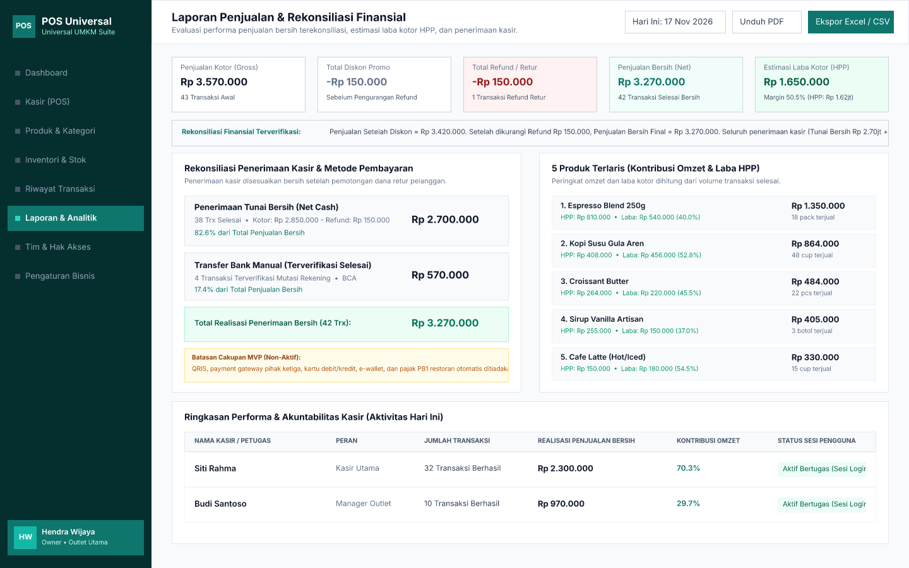 |

#### Team & Role Permissions (Node 4264) & Store Settings (Node 4380)
| Web Team Management (Node 4264) | Web Store & Bank Settings (Node 4380) |
| :---: | :---: |
| 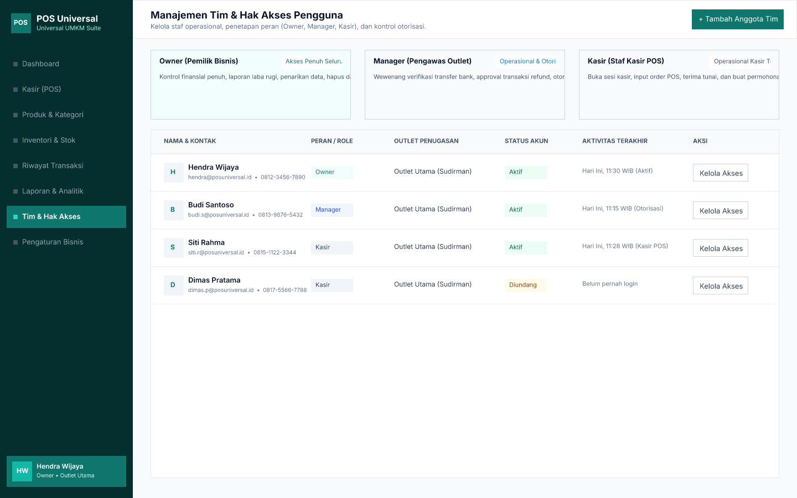 | 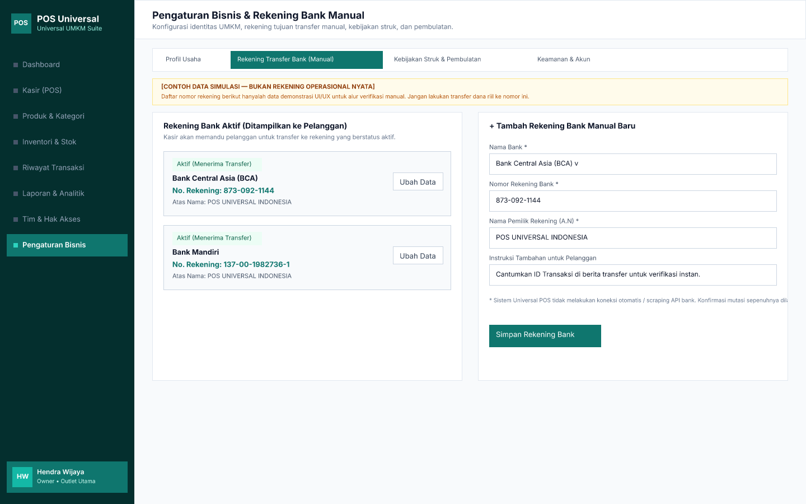 |

---

### Mobile Business Management Screens (Touch-First Mobile Web 390 × 844 px)

#### Mobile Products (Node 3321), Product Detail (Node 3403), Add Product Sheet (Node 3446)
| Mobile Catalog | Mobile Product Detail | Mobile Add Product Sheet |
| :---: | :---: | :---: |
| 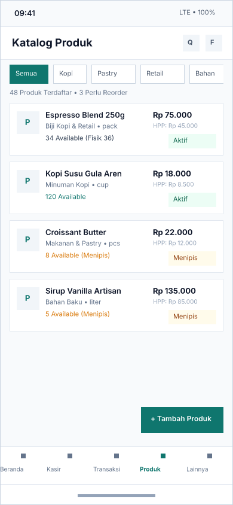 | 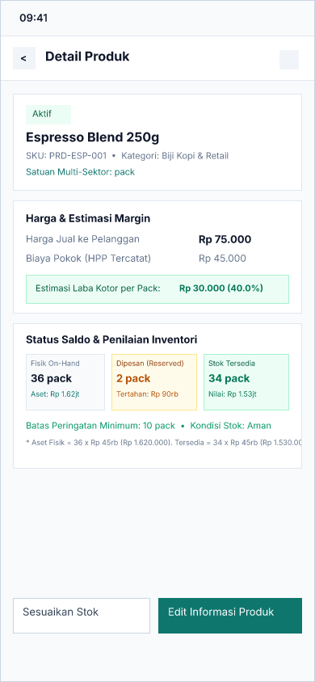 | 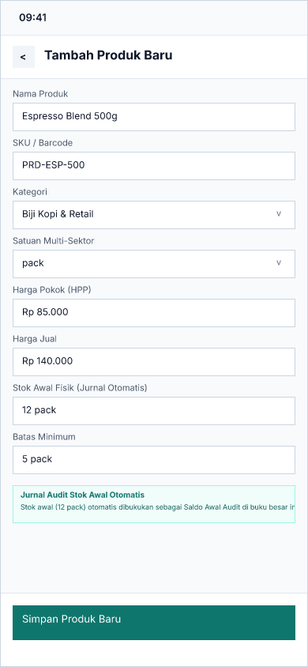 |

#### Mobile Inventory Overview (Node 3682) & Stock Adjustment Sheet (Node 3759)
| Mobile Inventory Overview | Mobile Stock Adjustment Sheet |
| :---: | :---: |
| 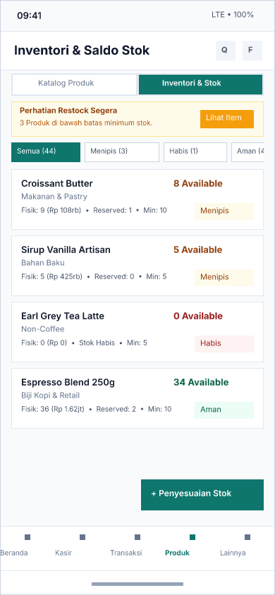 | 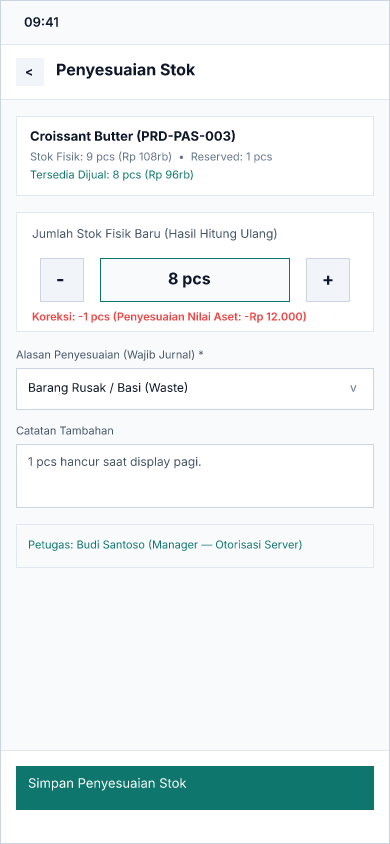 |

#### Mobile Transactions Feed (Node 3963) & Refund Screen (Node 4031)
| Mobile Transactions Feed | Mobile Refund Screen |
| :---: | :---: |
| 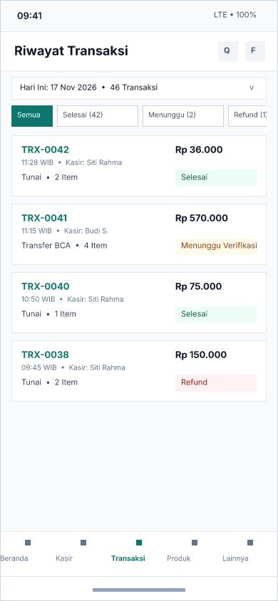 | 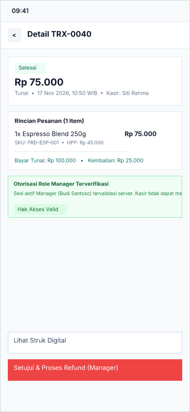 |

#### Mobile Sales Reports (Node 4199), Team Management (Node 4467), Settings (Node 4539)
| Mobile Sales Reports | Mobile Team Management | Mobile Settings & Bank |
| :---: | :---: | :---: |
| 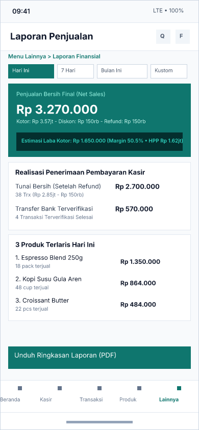 | 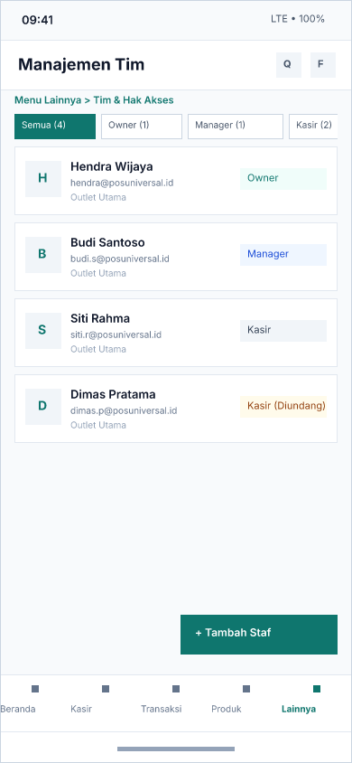 | 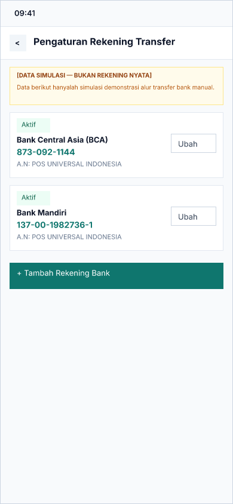 |

---

## 6. Bridge to Phase 4

With all screens for cashier operations and back-office management designed, Phase 4 conducted an exhaustive design audit to verify accounting formulas, visual alignments, RBAC enforcement, and data consistency across all native FigCraft documents.
