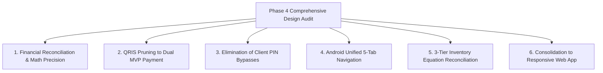

# Walkthrough 04 — Design Audit, Addendum & Corrections

**Design Phase:** Phase 4  
**Audit Scope:** Visual Reconciliation, Mathematical Precision, Security Hardening, Platform Consolidation & Scope Pruning  
**Audit Verdict:** **PASS (100% Reconciled)**  

---

## 1. Initial Objective

Prior to developer handoff, Phase 4 conducted an exhaustive, multi-point design and architectural audit of all native FigCraft documents. The objective was to eliminate any discrepancies between visual design nodes, business rules, accounting formulas, security models, and frontend component contracts.

---

## 2. Key Audit Areas & Corrections

---

### Correction 2.1: Mathematical & Financial Reconciliation
In preliminary design drafts, an accounting ambiguity existed between completed sales and net sales after returns:
- **Discrepancy:** The figure `Rp 3.420.000` (Gross Sales minus Discounts) was labeled as "Net Sales" on certain cards, despite a Rp 150.000 refund transaction occurring within the reference period.
- **Correction Applied:**
  The financial reporting hierarchy was formalized with absolute mathematical precision:
  $$\text{Gross Sales: Rp 3.570.000} - \text{Discounts: Rp 150.000} = \text{Pre-Refund Sales: Rp 3.420.000}$$
  $$\text{Pre-Refund Sales: Rp 3.420.000} - \text{Refunds: Rp 150.000} = \mathbf{Net\ Sales:\ Rp\ 3.270.000}$$
- **Receipts Balance Verification:**
  * Cashier Net Cash Tender: $\text{Rp 2.850.000} - \text{Rp 150.000} = \mathbf{Rp\ 2.700.000}$ (38 transactions)
  * Verified Bank Transfer (BCA): $\mathbf{Rp\ 570.000}$ (4 transactions)
  * Total Realized Receipts: $\text{Rp 2.700.000} + \text{Rp 570.000} = \mathbf{Rp\ 3.270.000}$ (**0.00 IDR variance** against Net Sales).
- **COGS / HPP Reconciliation:**
  Documented HPP of Rp 1.620.000 yields an exact Gross Profit of **Rp 1.650.000** (**50.46% margin**), reflected across all desktop and mobile report cards.

---

### Correction 2.2: Removal of QRIS in Favor of Dual Payment MVP
Preliminary wireframes explored an integrated QRIS payment flow. During the technical feasibility audit, QRIS was pruned from the MVP:
- **Dependency Overhead:** Dynamic QRIS requires an active aggregator contract (Midtrans, Xendit, or BCA QRIS API), merchant webhook infrastructure, and automated settlement reconciliation that complicates small business onboarding.
- **Architectural Pruning:** The design was updated to focus strictly and reliably on **Cash (Tunai)** and **Manual Bank Transfer**, with illustrative demo accounts for Bank Central Asia (BCA) and Bank Mandiri.
- **Preserved Archive:** The pre-removal design file was safely archived as `POS Universal — Design Foundation.pre_qris_removal.figcraft`.

---

### Correction 2.3: Elimination of Client-Side 4-Digit PIN Bypasses
Early cashier mockups allowed a cashier to type a 4-digit PIN on the client device to bypass manager restrictions for discounts and refunds:
- **Security Vulnerability:** Client-side PINs in web applications are easily reverse-engineered, shared verbally among staff, or bypassed in JavaScript.
- **Hardened Architecture:** All client-side PIN dialogs were removed. Sensitive operations (refunds, manual transfer verification, and negative stock adjustments) now specify a cryptographically signed **Manager Elevation Token** issued by the backend following authenticated session elevation.

---

### Correction 2.4: Unified 5-Tab Navigation on Mobile Web
Mobile screens in early drafts used varying navigation paradigms (some had floating action buttons, others had breadcrumbs or top navigation drawers):
- **Correction Applied:** Standardized all mobile web screens on a permanent, touch-friendly 5-tab bottom navigation bar:
  $$\text{Beranda} \quad|\quad \text{Kasir} \quad|\quad \text{Transaksi} \quad|\quad \text{Produk} \quad|\quad \text{Lainnya}$$
  This provides consistent, muscle-memory navigation for cashiers and store owners on smartphones.

---

### Correction 2.5: Reconciled 3-Tier Inventory Equation
Ensured every inventory screen, product detail sheet, and stock opname modal explicitly represents:
$$\text{Stok Tersedia (Available)} = \text{Stok Fisik (On-Hand)} - \text{Stok Dipesan (Reserved)}$$
This completely eliminates customer overselling when orders are pending bank transfer confirmation.

---

### Correction 2.6: Consolidation from Dual Targets to a Single Responsive Web Application
- **Original Exploration:** The design process initially created parallel desktop (1440 × 900 px) and Android-oriented UI references (390 × 844 px), with early handoff drafts evaluating a separate native Android APK (Kotlin / Jetpack Compose).
- **Architectural Realignment:** Technical evaluation highlighted that building and maintaining two separate platforms (Web + Android APK) would impose significant app store friction, update distribution delays, and elevated engineering costs for small businesses.
- **Resolution:** The project consolidated onto a **single, responsive Web application (React + Vite + Tailwind CSS + shadcn/ui)** deployed via Vercel. The 390 × 844 px design frames were formally designated as the **Mobile Web / Android browser** specification, preserving touch ergonomics without the overhead of an APK.

---

## 3. Audit Verdict & Sign-Off

| Audit Category | Criteria | Evaluated Status |
| :--- | :--- | :---: |
| **Visual Consistency** | Deep Teal `#0F766E` theme applied across all frames | **PASS** |
| **Typography Scale** | Inter font scale with strict proportional line heights | **PASS** |
| **Accounting Precision** | Net Sales, Drawer Receipts, and HPP balanced to 0 IDR | **PASS** |
| **Inventory Logic** | 3-tier equation enforced across all stock tables | **PASS** |
| **Security & RBAC** | Role selector and client PINs completely removed | **PASS** |
| **Touch Ergonomics** | 44px+ tap targets enforced on all mobile web controls | **PASS** |
| **Overall Handoff Verdict**| **APPROVED FOR PHASE 5 IMPLEMENTATION** | **PASS** |

---

## 4. Preservation of Historical Audit Evidence

In accordance with strict repository governance, no historical design files were deleted or overwritten. All intermediate versions remain intact in the local root workspace:
- `POS Universal — Design Foundation.pre_qris_removal.figcraft`
- `POS Universal — Phase 2 Core Screens.pre_corrections.figcraft`
- `POS Universal — Phase 2 Core Screens.pre_addendum.figcraft`
- `POS Universal — Phase 3 Business Management.pre_addendum.figcraft`

Only the latest, fully audited files are committed to the public `design/figcraft/` directory of this repository.
