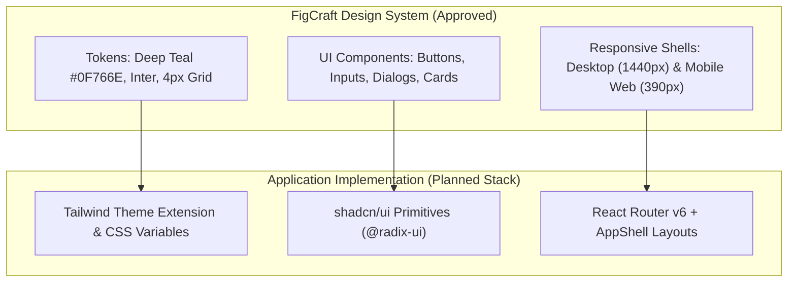
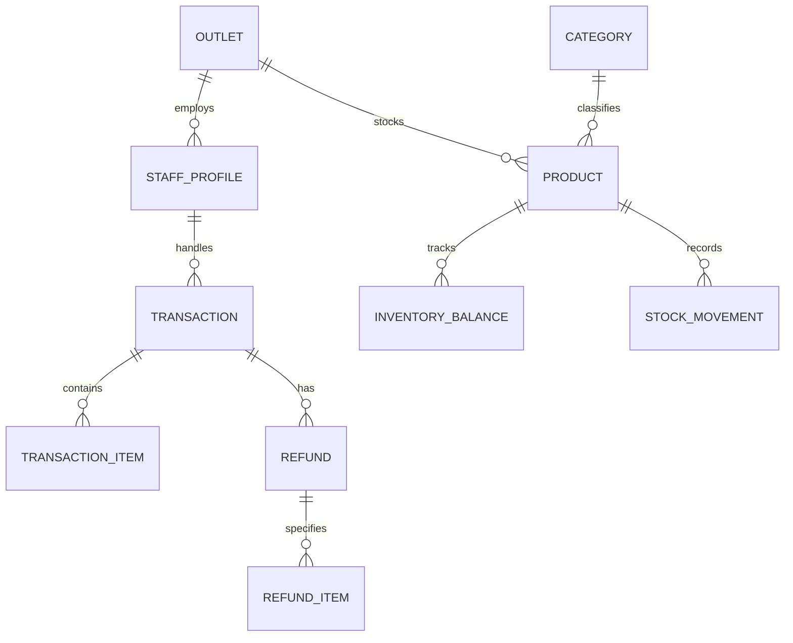

# Walkthrough 05 — Final Architecture & Engineering Handoff

**Phase:** Phase 5 Architecture Handoff  
**Design Status:** **100% COMPLETE & VERIFIED**  
**Engineering Repository:** Separate application workspace (`pos-universal`)  
**Planned Technology Stack:** React 18+, Vite, TypeScript, Tailwind CSS, shadcn/ui, Supabase (PostgreSQL 15+), Vercel  
**Document Purpose:** Architectural Specification & Developer Handoff Contract  

---

## 1. Architectural Overview & Design-to-Code Mapping

POS Universal bridges the gap between design and production code through a clean, domain-driven architecture. Every visual component in FigCraft has a direct counterpart in the planned web application:



---

## 2. Frontend Engineering Architecture

### 2.1 State Management Division (Specification)
1. **Client & Cart State (Zustand):**
   - Active shopping cart items, line-item discounts, and customer notes are specified to be managed in an in-memory `useCartStore` with local persistence (`sessionStorage`) to survive inadvertent page reloads.
   - Held carts (`holdCart`) are saved locally to allow cashiers to switch transactions instantly without backend calls.
2. **Server State & Caching (TanStack Query v5):**
   - Product catalog, category listings, transaction history, and stock opname logs are designed with optimistic updates and background revalidation.
   - Cashier checkout triggers automatic cache invalidation on `['products']` and `['inventory']`.

### 2.2 Tailwind CSS Configuration
The Deep Teal theme is configured via standard CSS variables:

```css
@layer base {
  :root {
    --primary: 173 80% 26%;        /* #0F766E - Teal 700 */
    --primary-foreground: 0 0% 100%;
    --primary-hover: 174 81% 22%;   /* #0D655E - Teal 800 */
    --background: 210 40% 98%;      /* #F8FAFC - Slate 50 */
    --surface: 0 0% 100%;          /* #FFFFFF - White */
    --border: 214 32% 91%;          /* #E2E8F0 - Slate 200 */
    --radius: 0.5rem;               /* 8px */
  }
}
```

---

## 3. Database Schema & Planned Supabase Architecture

The planned application data model is designed for PostgreSQL 15+ hosted on Supabase, leveraging strict ACID transactions and Row Level Security:



### Key Schema Entities (Contract):
1. `products`: Multi-sector units (`pcs`, `kg`, `liter`, `cup`, etc.), SKU, Barcode, Selling Price (`integer` Rupiah), Cost Price/HPP (`integer`), and `track_inventory` boolean.
2. `inventory_balances`:
   - `on_hand`: Physical stock on premise.
   - `reserved`: Stock held for pending bank transfers.
   - `available`: Generated column (`on_hand - reserved`).
3. `transactions`: Tracks `status` (`DRAFT`, `PENDING_TRANSFER`, `COMPLETED`, `CANCELLED`, `EXPIRED`, `REFUNDED`), `payment_method` (`CASH`, `BANK_TRANSFER`), cash tendered, and change.
4. `refunds`: Itemized customer returns linked to original transactions, tracking refunded amount, refund reason, and restock audit movements.
5. `bank_accounts`: Merchant bank accounts for transfer payment display.

---

## 4. Planned Automated Background Workers (pg_cron)

To guarantee that inventory reservations expire automatically without manual intervention, the architecture specifies an automated database worker running every 60 seconds using `pg_cron`:

```sql
SELECT cron.schedule('expire-stale-reservations', '* * * * *', $$
  WITH expired_orders AS (
    UPDATE transactions
    SET status = 'EXPIRED', updated_at = NOW()
    WHERE status = 'PENDING_TRANSFER'
      AND expires_at < NOW()
    RETURNING id
  )
  UPDATE inventory_balances ib
  SET reserved = ib.reserved - ti.quantity
  FROM transaction_items ti
  WHERE ti.transaction_id IN (SELECT id FROM expired_orders)
    AND ib.product_id = ti.product_id;
$$);
```
This specification ensures that unverified bank transfer reservations automatically release held stock back to `Available` after 60 minutes.

---

## 5. Implementation Status & Project Readiness

To maintain complete transparency regarding project progress:
- **UI/UX Design Package:** **100% COMPLETE & AUDITED** (All native FigCraft documents approved).
- **Technical Architecture & Specifications:** **100% COMPLETE** (All 10 specification documents verified).
- **Application Implementation:** In active development within the separate application workspace (`/home/xiao/Projects/pos-universal/`).
- **Production Deployment:** Not yet deployed to production. This repository serves as the definitive public design and architectural reference.
